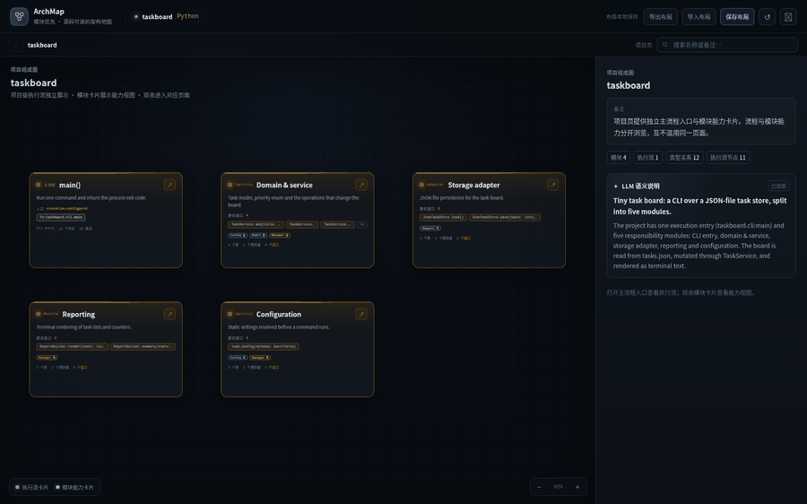
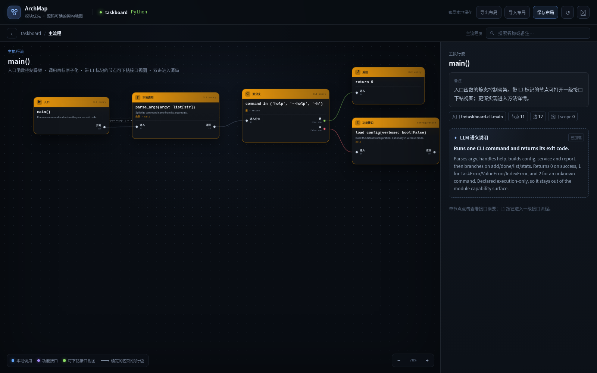

# ArchMap

**Turn a Python codebase into a drillable architecture map — without running it.**

[](https://merlinsassoon.github.io/dsh-archmap-explorer/)
[](https://github.com/MerlinSassoon/dsh-archmap-explorer/actions/workflows/ci.yml)


[](LICENSE)

▶ **[Live demo](https://merlinsassoon.github.io/dsh-archmap-explorer/)** — browse a real project's map in the browser, no install, no sign-up.

`archmap build .` writes one self-contained `architecture.html`:

```text
project overview  →  execution flow  →  module capability surface  →  method source & callers
```

Everything is static. No network, no execution of the analyzed code, no LLM tokens. The file opens from `file://`, survives an email attachment, and works on an air-gapped machine.



Three no-install demos, each a single HTML file:

| Demo | What it shows | Transfer |
|---|---|---|
| [taskboard](https://merlinsassoon.github.io/dsh-archmap-explorer/d1/architecture.html) | 5 modules, 19 functions, hand-written semantic annotations | 65 KB |
| [student_system](https://merlinsassoon.github.io/dsh-archmap-explorer/d2/architecture.html) | 6 modules, 52 functions, one server flow | 90 KB |
| [ArchMap itself](https://merlinsassoon.github.io/dsh-archmap-explorer/d3/architecture.html) | the analyzer analyzing its own 308 functions | 600 KB |

> The Web UI is currently in Chinese; labels in the screenshots are UI chrome, all content comes from your code.

## Quick start

```bash
pip install "git+https://github.com/MerlinSassoon/dsh-archmap-explorer.git"

cd your-python-project
archmap build .            # → .archmap/architecture.html
archmap serve .archmap     # optional: local preview
```

Requires Python 3.10+, no third-party runtime dependencies.

Or try the samples that ship with this repository:

```bash
git clone https://github.com/MerlinSassoon/dsh-archmap-explorer
cd dsh-archmap-explorer
python3 -m archmap build examples/taskboard --out /tmp/taskboard
open /tmp/taskboard/architecture.html   # xdg-open on Linux
```

## What it answers

| Question | Where it lives |
|---|---|
| Which modules exist and who owns what? | project page: one execution-flow card plus one card per capability module |
| What does the entry point actually do? | execution-flow page: bounded control skeleton — branches, loops, returns, dispatch |
| What does this module expose to the rest of the system? | module page: providers, public API surface, type relations in the right rail |
| Where is this method, who calls it, what does it call? | method page: source slice, callers, callees, unresolved calls kept separate |
| If I change this, what is affected? | `archmap impact before.json after.json` |
| What is the dependency structure? | `archmap dsm architecture.json --level module` |



## Pages

| Route | Page |
|---|---|
| `#/project` | Project: execution-flow cards and capability-module cards on the same grid |
| `#/flow[/<flowId>]` | Execution flow of one entry point |
| `#/flow/<flowId>/scope/<nodeId>` | Depth-1 interface scope of one orchestration callable |
| `#/module/<moduleId>` | Module capability surface: classes, providers, API surface |
| `#/module/<moduleId>/function/<functionId>` | Method detail: source, callers, callees, semantics |

Every page supports drag-to-arrange layouts, a resizable detail rail, and follows the system light/dark theme.

## CLI

```bash
archmap build <project> [--out DIR] [--config FILE] [--annotations FILE]
archmap check <architecture.json>          # structural validation, exit code friendly
archmap method <project> --file F --function NAME
archmap serve <dir>                        # local preview, no build step
archmap diff <before.json> <after.json>

# read-only queries, no writes to the bundle
archmap impact <before.json> <after.json>
archmap trace <architecture.json> --from <function-id> [--direction inbound]
archmap surfaces <architecture.json> [--module ID]
archmap dsm <architecture.json> [--level module|provider]

# LLM annotation sidecar (the model writes text, Python decides what is valid)
archmap annotations context <architecture.json> --scope functions --json
archmap annotations apply <architecture.json> --proposal proposal.json --provider <id> --model <id>
```

## Configuration

Settings are read from `archmap.config.json` at the project root, or from `--config`. A minimal file only needs modules, everything else has defaults:

```json
{
  "projectName": "my-project",
  "language": "python",
  "include": ["src/**/*.py"],
  "exclude": ["**/__pycache__/**", "**/.venv/**"],
  "entrypoints": ["src.app.main:main"],
  "executionEntrypoints": ["src.app.main:App.run"],
  "modules": [
    {
      "id": "app",
      "name": "Application entry",
      "include": ["src/app/**"],
      "note": "Entry points, configuration and top-level orchestration.",
      "role": "service"
    }
  ]
}
```

Full rules, decision tables and checklists live in [docs/archmap-config-generation.md](docs/archmap-config-generation.md) and [docs/archmap-architecture-spec.md](docs/archmap-architecture-spec.md).

## DSH plugin

ArchMap also ships as a DSH bundle. The plugin only bridges DSH tools to the bundled Python core — AST work, graph projection, validation and HTML rendering stay in Python.

```bash
dsh plugin --profile web add git+https://github.com/MerlinSassoon/dsh-archmap-explorer.git
dsh --profile web --dump-config        # expect id: tool-archmap
```

pnpm 10 may block the package `prepare` self-check; follow its message, add the exact `onlyBuiltDependencies` key to the target profile's `pnpm-workspace.yaml`, and retry. Details: [docs/dsh-plugin.md](docs/dsh-plugin.md).

| Tool | Purpose |
|---|---|
| `archmap_build` | Build `architecture.json` + self-contained HTML, return structured diagnostics |
| `archmap_annotate` | Generate source-level semantics through the DSH host model, refresh `missing/stale/all` |
| `archmap_query` | Read-only `check/trace/impact/surfaces/dsm/method` |
| `archmap_guide` | Read the bundled authoritative docs when no native `skill` tool exists |

The plugin carries two skills (`archmap-config-generation`, `archmap-code-conventions`) and the whole Python core, so users never `pip install` anything.

## What it deliberately is not

- **Not a runtime tracer.** No call stacks, no timing, no dynamic imports.
- **No statement-level CFG or dataflow.** Flows are bounded to one entry point's control skeleton; call targets stay atomic.
- **Dynamic dispatch is not guessed.** Unresolved calls, incomplete candidate sets and low-confidence relations are surfaced as such, never as facts.
- **Heuristic layout.** Dense graphs can overlap; layout overrides are exported from the page.
- **Python only.** An ArkTS front end is planned, not implemented.

If an answer looks certain but the analysis could not see the call, the tool is supposed to say so. That contract is the reason to prefer it over an LLM sketching a diagram.

## Documentation

- [README.zh.md](README.zh.md) — full Chinese documentation (configuration, contracts, plugin internals)
- [docs/archmap-v3-design.md](docs/archmap-v3-design.md) — design and data model
- [docs/dsh-plugin.md](docs/dsh-plugin.md) — plugin architecture, errors, acceptance commands
- [docs/schema/archmap-v6.4-bundle.schema.json](docs/schema/archmap-v6.4-bundle.schema.json) — bundle schema

## Development

```bash
python3 -m pytest -q                                  # Python core
npm test                                              # plugin
ARCHMAP_RUN_BROWSER=1 python3 -m pytest -q tests/test_browser_smoke.py

python3 -m archmap build . --config examples/archmap_v3.archmap.json --out .archmap/self
python3 -m archmap check .archmap/self/architecture.json
```

License: MIT.
