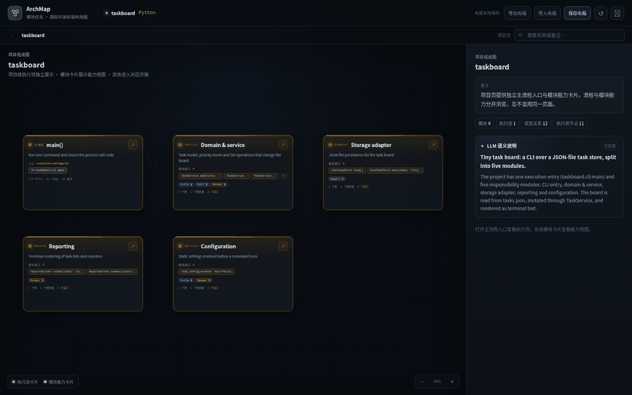
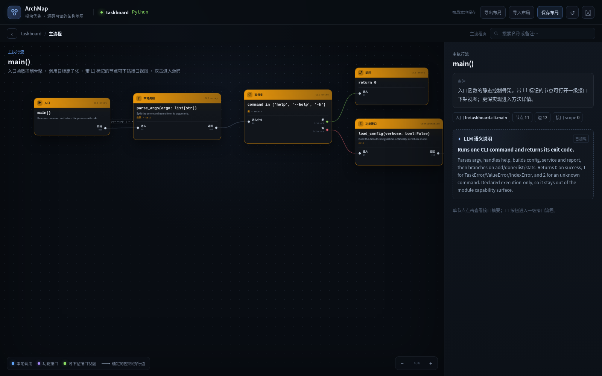
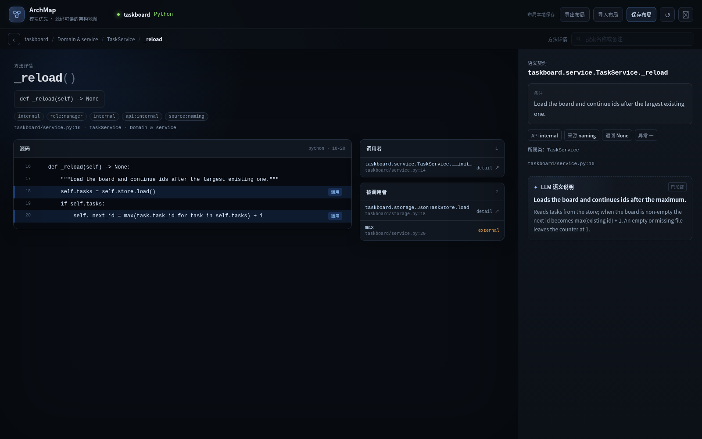

# ArchMap

**把 Python 仓库变成可逐层下钻的架构图，不用运行代码。**

[](https://merlinsassoon.github.io/dsh-archmap-explorer/)
[](https://github.com/MerlinSassoon/dsh-archmap-explorer/actions/workflows/ci.yml)


[](LICENSE)

▶ **[在线试玩](https://merlinsassoon.github.io/dsh-archmap-explorer/)**：免安装，直接在浏览器里打开一份真实项目的架构图。



一个命令，一个自包含 `architecture.html`：项目 → 执行流 → 模块 → 方法源码/调用者，四层逐层下钻。离线单文件，不联网、不运行被测代码、不消耗 token。

```bash
pip install "git+https://github.com/MerlinSassoon/dsh-archmap-explorer.git"
archmap build .        # → .archmap/architecture.html
```

> 当前版本：ArchMap 2.6.1 / DSH 插件 0.2.1 / bundle schema 6.4。<br>
> 适用语言：Python 3.10+（ArkTS 前端尚未实现）。<br>
> 运行依赖：无第三方运行时依赖；产物是 CLI + 自包含单文件 HTML。

```text
项目页（主流程入口 + 模块能力卡片）
  ├─ 主流程页（入口函数控制骨架；本地调用/功能接口原子化）
  │    ├─ 一级接口 scope（callable 的一级外部能力投影）
  │    └─ dispatch 候选旅程（候选 free_function 的一级 scope）
  └─ 模块能力页（右侧详情：模块组成 + 用户交互面 + 提供接口；画布：类/函数节点）
       └─ 方法详情页（源码 + 人类备注 + LLM 语义 + callers/callees）
```

## 能做什么

- 静态分析 Python 源码，生成项目、模块、执行流、Provider、API 能力和调用事实。
- 在项目页用同层卡片展示项目级主流程和普通能力模块。
- 以有界执行流展示入口函数的控制骨架：分支、多分支、循环、终止和动态 dispatch。
- 对编排 callable 生成深度固定为 1 的接口 scope；对完整 dispatch 候选集生成独立候选旅程。
- 展示模块能力契约、七类 Provider Role、类结构、继承/实现/组合关系和 User Surface；模块级信息统一在右侧详情栏，类型关系明细在类节点详情展示。
- 提供 Method Detail、源码切片、callers/callees、override/overridden-by 和多态调用邻域。
- 提供 `impact`、`trace`、`surfaces`、`dsm` 等只读查询。
- 输出稳定、可校验、可离线打开的 JSON 与 HTML。

ArchMap **不是**运行时追踪器，也不生成逐语句 CFG、数据流图或完整运行时调用树。静态解析不到的动态行为必须以 unresolved、候选不完整或诊断的形式显式保留，不能伪造确定关系。

## 在线演示与截图

三个无需安装的 demo（由本仓库样例现场构建）：

| demo | 内容 | 体积 |
|---|---|---|
| [taskboard](https://merlinsassoon.github.io/dsh-archmap-explorer/d1/architecture.html) | 5 模块小项目，含手写语义注解 | 390 KB（传输 65 KB） |
| [student_system](https://merlinsassoon.github.io/dsh-archmap-explorer/d2/architecture.html) | 6 模块终端项目，含服务器执行流 | 760 KB（传输 90 KB） |
| [ArchMap 自身](https://merlinsassoon.github.io/dsh-archmap-explorer/d3/architecture.html) | 308 个函数的自举分析 | 8.4 MB（传输 600 KB） |

| 执行流页 | 方法详情页 |
|---|---|
|  |  |

## 核心概念

### 三层投影

| 投影 | 作用 |
|---|---|
| `ProjectGraph` | 项目页：flow cards、普通能力模块、项目级入口与布局 |
| `ModuleGraph` | 模块能力页：Provider、公开 API、类、类型关系和模块内方法关系；模块摘要与用户交互面在右侧详情栏 |
| `ExecutionFlow` | 主流程页：入口控制骨架、一级 scope、dispatch 候选旅程 |

函数级事实统一保存在 `functionDetails` 和 `callSites` 中，供 Method Detail、影响分析、追踪和查询使用。

### 普通能力模块

所有模块都是普通能力模块，不存在主模块、`moduleKind` 或入口模块类型。模块 `role` 只表达职责：

```text
service / adapter / component / test / other
```

入口状态由项目级 `entrypoints` / `executionEntrypoints` 和 execution flow 表达，不属于模块 role 或 Provider Role。

### 七类 Provider Role

```text
config / model / manager / adapter / component / contract / utility
```

- `config` / `model` 以类型卡片和字段摘要展示；
- `manager` / `adapter` / `component` / `contract` 可提供方法和协议能力；
- `utility` 默认是内部实现，保留在事实层但不进入默认能力面；
- `entry` 不是 Provider Role，也不是模块 role。

### 能力边界

模块能力来自公开类方法、公开模块级自由函数、协议能力和继承能力。自由函数采用保守推断，可用模块配置控制：

```text
defaultFreeFunctionSurface: auto | internal | capability
```

流程入口和流程内部编排 callable 使用 `executionOnlyCallables` 声明。它们仍然保留在源码、调用关系和执行流中，但对 `providedApis`、Provider 卡片、能力计数和模块组合透明。

### 执行流边界

- 每条 flow 恰好一个标准 `entry` 节点。
- 只展开 entrypoint 自身控制骨架；调用目标作为原子执行节点，不递归穿透。
- 执行边只表达控制关系：`next` / `true` / `false` / `case` / `default` / `loop_body` / `loop_complete`。
- `return`、`break`、`continue` 是终止或循环标记，不生成普通出边。
- 一级 scope 深度固定为 1，`interface` 节点永远是黑盒能力边界。
- dispatch 在主流程中保持单一路由边界，候选旅程不向主画布新增候选控制边。

## 快速开始

```bash
# 在任意 Python 项目里生成架构图
archmap build .                       # → .archmap/architecture.html

# 或者用仓库自带样例
python3 -m archmap build examples/taskboard --out /tmp/taskboard
python3 -m archmap build examples/student_system --out /tmp/student_system

# 分析 ArchMap 自身
python3 -m archmap build . \
  --config examples/archmap_v3.archmap.json \
  --out .archmap/self

# 校验产物
python3 -m archmap check .archmap/self/architecture.json

# 查看单个函数/方法详情
python3 -m archmap method examples/student_system \
  --file student_system/student_system/menu/menu_manager.py \
  --function run

# 本地预览
python3 -m archmap serve .archmap/self
```

构建产物：

```text
.archmap/
├── architecture.json       # projectGraph + moduleGraphs + functionDetails + callSites
├── architecture.html       # 自包含交互页面
├── llm-annotations.json    # 可选输入
└── layout-overrides.json   # 前端可导出的布局覆盖
```

`architecture.html` 内联 bundle、CSS 和 JS，不需要 CDN、外部字体、外部图片或网络请求。

## 页面与路由

| 路由 | 页面 |
|---|---|
| `#/project` | 项目页：flow cards 与普通能力模块卡片 |
| `#/flow[/<flowId>]` | 主流程页：有界执行流 |
| `#/flow/<flowId>/scope/<nodeId>` | 一级接口 scope |
| `#/flow/<flowId>/dispatch/<nodeId>/candidate/<candidateScopeId>` | dispatch 候选旅程 |
| `#/module/<moduleId>` | 模块能力页 |
| `#/module/<moduleId>/function/<functionId>` | 方法详情页 |

交互约定：

- 项目页不绘制模块间依赖线；跨模块调用事实保留在 `callSites`、`functionDetails` 和查询接口中。
- 模块能力页不设顶部契约概览浮层；模块组成、用户交互面和提供接口统一在右侧详情栏展示，不默认绘制调用边。
- 类节点详情展示“类型层级”和“类型关系”；模块级类型关系只保留摘要计数，不展开全量列表。
- flow card 与 module card 同层、同网格；空能力模块后端保留，前端不渲染。
- 节点支持拖拽，布局覆盖保存在浏览器并由前端导出；默认坐标由 Python 生成。
- 右侧详情栏可拖拽调宽并独立持久化。
- 页面背景跟随系统浅色/深色模式。

## 配置

配置文件默认从项目根目录的 `archmap.config.json` 读取，也可通过 `--config` 指定。最小配置如下：

```json
{
  "projectName": "my-project",
  "language": "python",
  "include": ["src/**/*.py"],
  "exclude": ["**/__pycache__/**", "**/.venv/**"],
  "entrypoints": ["src.app.main:main"],
  "executionEntrypoints": ["src.app.main:App.run"],
  "modules": [
    {
      "id": "app",
      "name": "应用入口与编排",
      "include": ["src/app/**"],
      "note": "入口、配置与顶层编排。",
      "role": "service",
      "defaultFreeFunctionSurface": "internal",
      "executionOnlyCallables": ["src.app.main:main"]
    },
    {
      "id": "orders",
      "name": "订单能力",
      "include": ["src/orders/**"],
      "role": "service"
    }
  ]
}
```

主要配置域：

| 配置 | 用途 |
|---|---|
| `entrypoints` | 项目静态分析根、User Surface 传播和调用事实 |
| `executionEntrypoints` | 选择主流程叙事起点；省略时回退到 `entrypoints` |
| `modules[].role` | 普通能力模块职责：`service/adapter/component/test/other` |
| `modules[].defaultFreeFunctionSurface` | 模块级自由函数的默认能力面 |
| `modules[].executionOnlyCallables` | 对能力面透明、但保留在源码与执行流中的 callable |
| `flowScopes` | 一级接口 scope 的开关、roots、自动发现和预算 |
| `dispatchHints` | 动态分发候选集合及完整性声明 |
| `dispatchCandidates` | dispatch 候选旅程开关与预算 |
| `contract.apiExposure` | 单函数 public/internal 例外 |
| `contract.providerRoles` | 必要的七角色显式覆盖 |
| `contract.publicTags` / `internalTags` | 备注或装饰器中的公开/内部标签 |

配置生成的完整规则、决策表和检查清单见：

- [`archmap-config-generation`](docs/archmap-config-generation.md)：模块配置生成 Skill
- [`archmap-code-conventions`](docs/archmap-code-conventions.md)：源码编写与重构约定 Skill

## 动态分发与一级 scope

### `dispatchHints`

用于给静态解析不到的动态分发声明候选集：

```json
{
  "dispatchHints": [
    {
      "function": "src.app.main:main",
      "expression": "handlers[mode]",
      "occurrence": 1,
      "candidates": ["src.app.handlers:handle_a", "src.app.handlers:handle_b"],
      "complete": true,
      "reason": "config"
    }
  ]
}
```

候选集无法确认完整时必须设置 `complete: false` 并说明原因，不能伪造完整路由。

### `flowScopes`

```json
{
  "flowScopes": {
    "enabled": true,
    "roots": ["src.app.main:server"],
    "autoDetect": true,
    "maxScopesPerFlow": 6,
    "maxNodesPerScope": 24,
    "maxEdgesPerScope": 32
  }
}
```

- `flowScopes` 默认开启；显式 `enabled: false` 可完全关闭。
- scope root 必须是 `free_function` 编排 callable；`interface` 节点不能展开。
- `executionOnlyCallables` 可成为显式 root。
- `autoDetect` 只做保守候选发现，显式 roots 优先。
- scope 只展示直接外部能力接口和必要控制骨架，深度固定为 1。
- 预算截断会写入 scope diagnostics。

### `dispatchCandidates`

```json
{
  "dispatchCandidates": {
    "enabled": true,
    "completeOnly": true,
    "maxScopesPerDispatch": 16,
    "maxScopesPerFlow": 32,
    "maxNodesPerScope": 24,
    "maxEdgesPerScope": 32
  }
}
```

默认关闭。开启后只把已解析且满足完整性要求的 dispatch 候选投影为独立一级 scope，不改变主流程控制边。

## CLI

```bash
python -m archmap build <project> [--out DIR] [--config FILE] [--split] [--json] [--annotations FILE]
python -m archmap check <architecture.json> [--json]
python -m archmap method <project> [--file FILE] [--function NAME] [--json]
python -m archmap serve <directory> [--port 8765]
python -m archmap diff <before.json> <after.json>

# LLM 注解上下文 / 侧车写入
python -m archmap annotations context <architecture.json> --scope functions --max-nodes 50 --json
python -m archmap annotations apply <architecture.json> --proposal proposal.json --provider <id> --model <id> --json

# 只读查询
python -m archmap impact <before.json> <after.json> [--json]
python -m archmap trace <architecture.json> --from <function-id> [--direction inbound]
python -m archmap surfaces <architecture.json> [--module ID] [--json]
python -m archmap dsm <architecture.json> [--level module|provider] [--json]
```

`impact`、`trace`、`surfaces` 和 `dsm` 是按需查询结果，不写入默认 `architecture.json`。

## 人工备注与 LLM 注解

- 函数备注优先取 docstring 第一段，其次取函数体首部紧邻注释块。
- 备注和源码参与 `sourceHash`；LLM 文本不写回源码，而是放在独立侧车文件。
- 构建时自动读取输出目录或项目 `.archmap/llm-annotations.json`，也可使用 `--annotations`。
- 注解的 `sourceHash` 不匹配时，页面会标记为已过期。

```json
{
  "version": 1,
  "nodes": {
    "fn:app.main.main": {
      "summary": "程序主入口",
      "details": "加载数据并编排后续步骤。",
      "sourceHash": "sha256:..."
    }
  }
}
```

注解生成由确定性命令边界支撑：

- `annotations context` 从项目、模块和函数事实生成有界上下文，包含签名、人工备注、源码摘录、权威 `sourceHash` 和已有注解摘要；支持 `missing/stale/all` 三种刷新模式，先过滤再截断，不调用模型。
- `annotations apply` 严格校验 proposal，只接受 bundle 中存在的节点；`sourceHash` 始终使用 bundle 原值。默认保留已有注解，`--force` 才允许覆盖。写入后合并 `llm-annotations.json` 并重新渲染 `architecture.html`。

## 数据契约

当前 bundle 为 schema 6.4，顶层结构：

```text
kind / schemaVersion / project / entrypoints
projectGraph
moduleGraphs
functionDetails
callSites
diagnostics
stats
```

当前权威文档：

- [数据与扩展设计](docs/archmap-v3-design.md)
- [架构与编码规范](docs/archmap-architecture-spec.md)
- [API 契约模型](docs/archmap-api-contract-model.md)
- [bundle schema 6.4](docs/schema/archmap-v6.4-bundle.schema.json)
- [DSH 插件](docs/dsh-plugin.md)

历史阶段计划、旧交接、旧验收和旧 schema 统一归档在 [`docs/旧文档/`](docs/旧文档/README.md)，仅用于追溯，不代表当前契约。

## 面向 AI 的编程规范

以下两份文档是 AI 编写被分析项目和生成模块配置时的执行规范：

- [`archmap-code-conventions`](docs/archmap-code-conventions.md)：源码结构、模块边界、Provider Role、能力面、入口执行流、备注和测试要求。
- [`archmap-config-generation`](docs/archmap-config-generation.md)：从源码事实生成和校验 `archmap` 配置的固定算法、字段语义、反例和验收清单。

## DSH 插件：dsh-archmap-explorer

ArchMap 同时提供 DSH bundle 插件。插件只做 DSH 适配、宿主模型调用和 Python 子进程桥接；AST、图投影、校验、注解合法性和 HTML 渲染仍由随包分发的 Python 核心完成。

```text
npm 包名：dsh-archmap-explorer（尚未发布到 npm，当前请用下方 Git 方式安装）
当前版本：0.2.1（Git 标签 dsh-plugin-v0.2.1）
许可证：MIT
目标 DSH：0.2.2-rc.1
Python：3.10+，随 npm 包分发，无需预先 pip install
```

### 安装

```bash
dsh plugin --profile web add git+https://github.com/MerlinSassoon/dsh-archmap-explorer.git
```

安装后可检查：

```bash
dsh --profile web --dump-config
dsh --profile web --dump-config-schema
```

pnpm 可能拦截包的 `prepare` 自检脚本。按安装输出提示，在目标 profile 的 `pnpm-workspace.yaml` 中加入 `onlyBuiltDependencies` 的精确 key 后重试。完整说明见 [`docs/dsh-plugin.md`](docs/dsh-plugin.md)。

### 工具

| 工具 | 作用 |
|---|---|
| `archmap_build` | 生成 `architecture.json` 与自包含 `architecture.html`，返回模块/函数/执行流/结构化诊断统计 |
| `archmap_annotate` | 通过 DSH 宿主模型生成源码语义注解，支持 `missing/stale/all` 增量刷新并重渲染 HTML |
| `archmap_query` | 只读执行 `check/trace/impact/surfaces/dsm/method` 查询，优先替代手工 CLI 调用 |
| `archmap_guide` | 原生 `skill` 工具不可用时读取 bundled 权威规范，作为确定性 fallback |

`archmap_annotate` 必须走 DSH `ctx.llm`，不读取 API Key。模型路由顺序为：

```text
插件配置 provider/model
  → 当前会话模型
  → 第一个可用 provider
  → HOST_MODEL_UNAVAILABLE
```

模型只返回语义文本；`nodeId`、bundle 身份和 `sourceHash` 均由 Python 权威校验。默认保留已有/人工注解，`force` 才允许覆盖。

### Bundled Skill

- `archmap-config-generation`：生成和校验 `archmap.config.json`
- `archmap-code-conventions`：编写符合 ArchMap 模块、能力面、执行流和测试约定的 Python 代码

两份 Skill 正文直接读取包内权威文档。配置生成 Skill 缺失或为空时，插件加载失败。

详细架构、配置、错误处理和验收命令见 [`docs/dsh-plugin.md`](docs/dsh-plugin.md)。发布状态、验证边界和后续维护事项见 [`docs/HANDOFF-DSH-PLUGIN-0.2.1.md`](docs/HANDOFF-DSH-PLUGIN-0.2.1.md)；0.2.0 与 0.1.0 交接作为历史保留。

## 当前边界

- 仅实现 Python 前端；ArkTS 前端尚未实现。
- 静态解析无法覆盖任意动态 `getattr`、`**kwargs` 分发、运行时注册表和完整运行时调用路径。
- 方法详情中的源码切片有长度上限，超大函数会标记为 truncated。
- 宏布局仍使用启发式，局部重叠和边界情况需要持续校验。
- 类焦点页和类内方法图不在当前产品计划中。
- 不生成逐语句节点、列表操作节点、`try/except` 异常控制、数据流边或图内递归下钻。
- 序列协议（`__len__` / `__getitem__` / `__contains__` / 切片 / ArkTS index signature）暂不进入能力模型。
- 继承与多态只覆盖项目内可解析的 canonical class；第三方、条件导入和运行时注入可能产生低置信度或遗漏。
- User Surface 是静态 primitive + entrypoint 可达性启发式，不等同于完整 UX 或运行时分析。
- 模块层次 / 子模块尚未建模，当前模块配置是扁平的。
- `impact` / `trace` 受 `maxDepth` / `maxNodes` 限制，截断时必须在结果中关注 `truncated`。
- executionOnly callable、自由函数表面和 scope 自动发现都依赖显式配置或保守证据；静态解析不到的内容不会伪造。

## 开发与验证

```bash
# 全量测试（浏览器测试默认跳过）
python -m pytest -q

# 浏览器冒烟测试
ARCHMAP_RUN_BROWSER=1 python -m pytest -q tests/test_browser_smoke.py
```

发布前至少确认：

```bash
python3 -m archmap build . --config examples/archmap_v3.archmap.json --out .archmap/self
python3 -m archmap check .archmap/self/architecture.json
```

架构变更必须同步更新当前数据契约、schema、测试和上述权威文档；过程性记录不得反向改写为当前设计。
