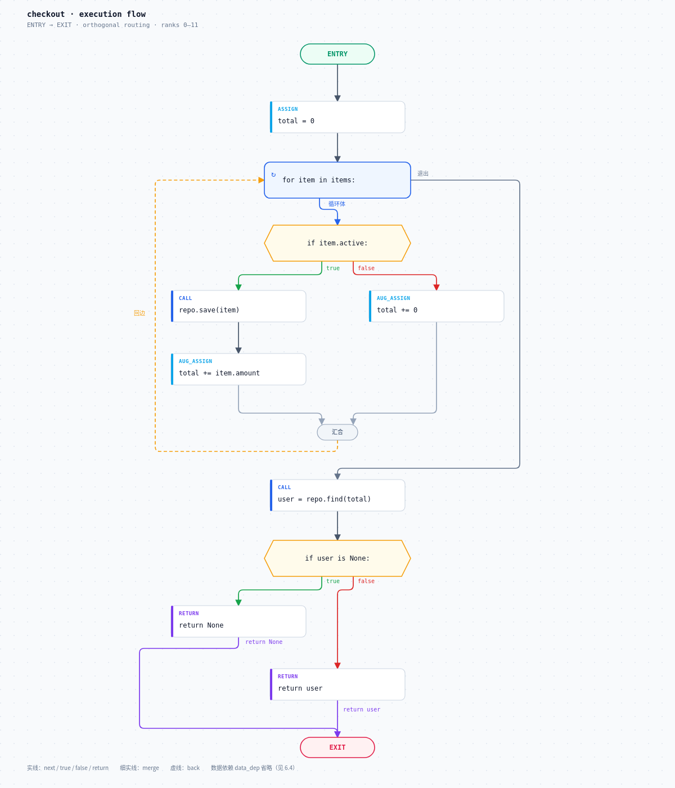

# dsh-archmap 2.0 设计文档（已归档）

> **归档状态（2026-11-17）**：本文档仅用于追溯 2.0 函数内部执行流设计。当前产品已在 P1.5 移除 FunctionFlow，默认 bundle、UI 和流水线均不再包含语句级执行流。
>
> **当前契约更新**：当前 API 契约以 [`archmap-api-contract-model.md`](../archmap-api-contract-model.md) 为准；P2.2 Provider Role（config/model/manager/entry/...）与 P2.3 ArchMap 自身分层重构已批准，详见 [`HANDOFF-P2-P4.md`](HANDOFF-P2-P4.md)。
>
> 当前权威文档：[项目 README](../README.md)、[P2–P4 交接](HANDOFF-P2-P4.md)、[v3 数据契约](../archmap-v3-design.md)、[P1.5 实现记录](function-detail-p1.5-plan.md)、[文档索引](README.md)。
>
> **原文定位**：把 Python 项目变成“从 ENTRY 到 EXIT”的可下钻执行流图。
> **原文状态**：重构基线（Draft 1.0），用于替换 1.x 的“依赖图 + 执行流”混合模型。
> **原文约束**：纯 Python 分析后端；前端只渲染，不做图算法。

---

## 阅读路线

- **决策者**：0（摘要）、10（验收）；10 分钟。
- **实现者**：2（Schema）→ 3（AST）→ 4（布局）→ 5（路由）→ 8（模块）→ 9（实施）。
- **设计评审**：1（原则）、4.6（样例）、5（正交）、7（交互）、9.5（风险）。

---

## 0. 一页纸摘要

### 0.1 这次重构改什么

| 维度 | 1.x | 2.0 |
|---|---|---|
| 分析语言 | JavaScript/TypeScript + Python | **仅 Python**（标准库 `ast`） |
| 默认视图 | 模块平铺 / 依赖图 | **函数执行流**（打开项目即入口函数） |
| 函数间调用 | 平级的 `calls` 箭头 | **调用步骤卡片**（`stepType: "call"`） |
| 导入关系 | `imports` 边 | **不建模**，不出现 |
| 入口/出口 | 无 | 每个函数固定 **ENTRY / EXIT** |
| 边类型 | 13 种 | **2 种**：`next_step`、`data_dep` |
| 连线 | 贝塞尔与正交混用 | **全部正交折线**（90° 圆角） |
| 布局位置 | 前端 JS 计算 | **Python 预计算**，前端只消费坐标 |
| 交互重点 | 多视图切换 | **双击 call step 下钻** |
| 数据流 | 独立模式 | 紫色虚线叠加，可开关 |

### 0.2 七个不可违反的不变量

1. **一个函数 = 一张画布**。不存在“把多个函数平铺在同一页”的视图。
2. 每个函数图**恰好一个 ENTRY、一个 EXIT**；所有控制流从 ENTRY 出发，最终到达 EXIT。
3. 图中**不存在** `imports` 边，**不存在**平级函数之间的 `calls` 边。
4. 函数 A 调 B，只表现为 A 内部的 `call` 步骤；B 的细节只能通过双击该步骤下钻。
5. 只有两种边：`next_step`（控制流）和 `data_dep`（数据流）。`data_dep` 不影响 rank。
6. 所有连线是横平竖直的折线（拐角 8px 圆角）；`true` 走左、`false` 走右；循环回边走**局部左侧 Lane**。
7. 布局是**确定性**的：同样输入产生逐字节相同的坐标与 `d` 路径。

### 0.3 非目标

- 不做模块依赖图、包图、类图、ER 图。
- 不做跨函数的数据流（只做函数内 def-use）。
- 不在前端做自动布局、力导向、通用 DAG 布局。
- 不追求“一次看完整仓库”；追求“一次看懂一条执行路径”。

> **设计取舍**：单一执行流视图会隐藏跨模块依赖。这是有意的。跨模块信息通过“入口函数列表 + 函数搜索 + 详情面板的 callee 列表”提供，而不是再加一张依赖图。

---

## 1. 设计原则

### 1.1 执行流是唯一的叙事

架构图回答的问题不是“有哪些模块”，而是：

> 程序从启动到结束，经过了哪些判断、循环、调用和数据读写？

因此页面只有一个主语：**当前函数**。所有视觉元素都服务于“读一条路径”。

### 1.2 调用是步骤，不是兄弟节点

```text
错误（1.x）：  A ──calls──▶ B        B 与 A 平级
正确（2.0）：  A 的内部： … → [Step: 调用 B] → …   B 是 A 的黑盒步骤
```

`call` 步骤携带 `call.targetFunctionId`。前端据此提供下钻，不把 B 画到 A 的页面上。

### 1.3 结构化 CFG，而不是任意图

Python AST 天然是结构化的。布局算法不假设“任意 DAG”，而是假设：

- `if` 有 then/else 两个 arm 和一个 merge；
- `loop` 有一个 body、一个 after、一条 back 边；
- `sequence` 是线性语句块。

这个假设让 **Merge 居中对齐** 和 **局部 Lane** 可以“构造即正确”，而不是事后修补。

### 1.4 语义与几何分离

- `nodes` / `edges` / `blocks` 是**语义**；
- `layout` 是**几何**（可缺省、可重新生成）；
- 语义指纹不包含几何，几何变化不影响“代码有没有变”的判断。

### 1.5 纯 Python 后端

AST 解析、CFG 构建、数据流、rank、x 坐标、Lane、折线路径、HTML 模板全部由 Python 完成。前端 JS 只做：

- 把 `layout.edges[id].d` 塞进 `<path d="...">`；
- pan / zoom / hover / click / dblclick / 面包屑 / 详情面板；
- 下钻动画与 URL 同步。

DSH 的 Cordis 插件仍然是 JS，但它只是一个 **~100 行的进程桥**：找 Python、spawn、传 JSON、接结果。没有任何分析逻辑。

### 1.6 确定性优先

- 节点/边按 ID 排序后输出；
- 布局常量固定，不使用随机数、不依赖字体测量（固定宽度 + 省略号）；
- `generatedAt` 不参与指纹；可用 `SOURCE_DATE_EPOCH` 覆盖；
- 同一份源码重复构建，`layout` 逐字节一致。

---

## 2. Graph Schema

> 机器可读版本：[`docs/schema/workflow-2.0.schema.json`](schema/workflow-2.0.schema.json)
> 完整样例：[`docs/schema/example-checkout.json`](schema/example-checkout.json)

### 2.1 顶层结构

```json
{
  "schemaVersion": "2.0",
  "kind": "archmap.execution-graph",
  "project": { "...": "..." },
  "entrypoints": [ { "functionId": "fn:app.cli.main", "reason": "main" } ],
  "functions": [ { "...": "..." } ],
  "diagnostics": [ { "...": "..." } ],
  "stats": { "...": "..." }
}
```

| 字段 | 类型 | 说明 |
|---|---|---|
| `schemaVersion` | `"2.0"` | 破坏性升级，1.x 图不可直接复用 |
| `kind` | `"archmap.execution-graph"` | 固定值，便于消费者识别 |
| `project` | object | 项目元信息 + 指纹 |
| `entrypoints` | array | 程序入口函数；没有时 HTML 显示入口选择器 |
| `functions` | array | 每个元素是一张独立执行流图 |
| `diagnostics` | array | 扫描/构建期诊断，不阻断渲染 |
| `stats` | object | 计数与最大 rank |

`project`：

```json
{
  "name": "shop",
  "root": ".",
  "language": "python",
  "pythonVersion": "3.10",
  "generatedAt": "2026-11-15T10:00:00Z",
  "fingerprint": "sha256:…"
}
```

- `root` 必须是**相对路径**，保证产物可跨机器复现。
- `fingerprint` 是语义指纹（见 2.8），不包含 `layout`、`generatedAt`、`stats`。

### 2.2 Node

| 字段 | 必填 | 说明 |
|---|---|---|
| `id` | 是 | 全局唯一；命名见 2.7 |
| `type` | 是 | `entry` / `exit` / `step` / `branch` / `loop` / `merge` |
| `code` | 是 | 源码片段或固定标签；`ENTRY` / `EXIT` / merge 用空串 |
| `synthetic` | 是 | 无源码证据的节点（entry/exit/merge）为 `true` |
| `blockId` | 是 | 所属结构块，用于布局 |
| `stepType` | `type=step` 必填 | `assign` / `call` / `return` / …（见附录 A） |
| `file`/`line`/`endLine` | `synthetic=false` 必填 | 源码证据 |
| `order` | 否 | 函数内语义序号，从 1 开始；merge 无 |
| `call` | `stepType=call` 必填 | 调用目标与置信度 |
| `data` | 否 | `{defs: [], uses: []}`，便于调试与详情面板 |
| `loopKind` | `type=loop` 必填 | `for` / `while` / `async_for` / `do_while` |
| `mergeOf` | `type=merge` 必填 | 所属 branch 的节点 ID |

`call` 对象：

```json
{
  "name": "find",
  "qualifiedName": "UserRepository.find",
  "targetFunctionId": "fn:app.repository.UserRepository.find",
  "resolved": true,
  "external": false,
  "recursive": false,
  "confidence": "high",
  "candidates": []
}
```

- `resolved=true` 时 `targetFunctionId` 必须是字符串；
- `external=true` 表示库/内置函数，不可下钻；
- `candidates.length > 1` 时前端在详情面板提供选择，不直接跳转；
- `confidence` 表示解析把握，不表示运行时会一定调用。

> 关键：**没有 `calls` 边**。调用关系只存在于 `call` 对象里。

### 2.3 Edge

只有两种 `type`：

| type | 语义 | `flow` |
|---|---|---|
| `next_step` | 控制流 | 非空，见下表 |
| `data_dep` | 函数内数据依赖 | 固定 `null` |

`flow` 闭合枚举：

| flow | 起点 → 终点 | 视觉 |
|---|---|---|
| `next` | 顺序执行 | 灰色实线 |
| `true` | branch → then 首节点 | 绿色实线，左端口 |
| `false` | branch → else 首节点 | 红色实线，右端口 |
| `loop_body` | loop → body 首节点 | 蓝色实线 |
| `loop_exit` | loop → after 首节点 | 灰色实线，右侧 Lane |
| `back` | body 末节点 → loop | 橙色虚线，左侧 Lane |
| `break` | break 步骤 → after | 橙色虚线，右侧 Lane |
| `continue` | continue 步骤 → loop | 橙色虚线，左侧 Lane |
| `return` | return 步骤 → EXIT | 紫色实线，右侧全局 Lane / 总线 |
| `exception` | raise / except 路径 → EXIT 或 handler | 红色虚线 |
| `merge` | arm 末节点 → merge | 浅灰细线 |

`data_dep` 额外字段：

```json
{
  "type": "data_dep",
  "flow": null,
  "variable": "total",
  "resolution": "exact",
  "confidence": "high"
}
```

`resolution`：

- `exact`：单一生产者，直线路径可证明；
- `union`：多个分支生产者汇合，边从每个生产者分别连出；
- `loop`：循环携带依赖，保守标注；
- `approximate`：属性/下标等只追踪到基变量。

### 2.4 Block（布局结构）

`blocks` 是布局的“骨架”，也是语义的显式化。渲染器可以忽略它，但布局引擎需要它。

三种 block：

```json
[
  { "id": "b:…:root", "kind": "sequence", "parentId": null,
    "items": ["n:…:1", "b:…:loop", "n:…:8", "b:…:if2", "n:…:12"] },
  { "id": "b:…:if1", "kind": "if", "parentId": "b:…:loop_body",
    "ownerId": "n:…:3", "then": "b:…:then", "else": "b:…:else", "merge": "n:…:m1" },
  { "id": "b:…:loop", "kind": "loop", "parentId": "b:…:root",
    "ownerId": "n:…:2", "body": "b:…:loop_body" }
]
```

- `items` 可包含节点 ID 或 block ID；顺序即源码顺序。
- `if.else` 允许 `null`（无 else 的 if）。
- `if.merge` 允许 `null`：当一支以 `return/raise` 终止时，不需要汇合点。
- `loop` 的 header 节点由 `ownerId` 指向，不在父 `items` 里重复。
- block 树必须无环、每个 block 恰好一个父（root 除外）。

### 2.5 Layout（几何输出）

```json
{
  "canvas": { "width": 1200, "height": 1400, "padding": 48 },
  "nodes": {
    "n:…:1": { "x": 480, "y": 180, "w": 240, "h": 56 }
  },
  "edges": {
    "e:…:4": {
      "d": "M 572 464 L 572 480 Q 572 488 564 488 L 432 488 Q 424 488 424 496 L 424 516",
      "label": { "x": 470, "y": 480, "text": "true" }
    }
  }
}
```

- `d` 是最终 SVG path，前端直接使用。
- `points` 可选，仅用于调试/测试；生产可省略。
- 所有 `d` 只允许 `M` / `L` / `Q`；`L` 必须水平或垂直。
- 每个节点的 `x,y` 是左上角，`w,h` 是固定尺寸。

### 2.6 完整示例

函数：

```python
# app/checkout.py
def checkout(items: list[Item], repo: UserRepository) -> User | None:
    total = 0
    for item in items:
        if item.active:
            repo.save(item)
            total += item.amount
        else:
            total += 0
    user = repo.find(total)
    if user is None:
        return None
    return user
```

对应 JSON（为可读性，数组元素一行一个；完整缩进版见 [`example-checkout.json`](schema/example-checkout.json)）。示例中的 `fingerprint` 与 `generatedAt` 为占位值：

```json
{
  "schemaVersion": "2.0",
  "kind": "archmap.execution-graph",
  "project": {"name": "shop", "root": ".", "language": "python", "pythonVersion": "3.10", "generatedAt": "2026-11-15T10:00:00Z", "fingerprint": "sha256:0000000000000000000000000000000000000000000000000000000000000000"},
  "entrypoints": [
    {"functionId": "fn:app.cli.main", "reason": "main"}
  ],
  "functions": [
    {
      "id": "fn:app.checkout.checkout",
      "name": "checkout",
      "qualifiedName": "app.checkout.checkout",
      "module": "app.checkout",
      "file": "app/checkout.py",
      "line": 1,
      "endLine": 12,
      "signature": "checkout(items: list[Item], repo: UserRepository) -> User | None",
      "isAsync": false,
      "rootBlockId": "b:app.checkout.checkout:root",
      "entryNodeId": "n:app.checkout.checkout:entry",
      "exitNodeId": "n:app.checkout.checkout:exit",
      "nodes": [
        {"id": "n:app.checkout.checkout:entry", "type": "entry", "code": "ENTRY", "synthetic": true, "blockId": "b:app.checkout.checkout:root"},
        {"id": "n:app.checkout.checkout:1", "type": "step", "code": "total = 0", "synthetic": false, "blockId": "b:app.checkout.checkout:root", "file": "app/checkout.py", "line": 2, "endLine": 2, "stepType": "assign", "order": 1, "data": {"defs": ["total"], "uses": []}},
        {"id": "n:app.checkout.checkout:2", "type": "loop", "code": "for item in items:", "synthetic": false, "blockId": "b:app.checkout.checkout:root", "file": "app/checkout.py", "line": 3, "endLine": 8, "loopKind": "for", "order": 2},
        {"id": "n:app.checkout.checkout:3", "type": "branch", "code": "if item.active:", "synthetic": false, "blockId": "b:app.checkout.checkout:loop_body", "file": "app/checkout.py", "line": 4, "endLine": 7, "order": 3},
        {"id": "n:app.checkout.checkout:4", "type": "step", "code": "repo.save(item)", "synthetic": false, "blockId": "b:app.checkout.checkout:then", "file": "app/checkout.py", "line": 5, "endLine": 5, "stepType": "call", "order": 4, "data": {"defs": [], "uses": ["item"]}, "call": {"name": "save", "qualifiedName": "UserRepository.save", "targetFunctionId": "fn:app.repository.UserRepository.save", "resolved": true, "external": false, "confidence": "high", "recursive": false}},
        {"id": "n:app.checkout.checkout:5", "type": "step", "code": "total += item.amount", "synthetic": false, "blockId": "b:app.checkout.checkout:then", "file": "app/checkout.py", "line": 6, "endLine": 6, "stepType": "aug_assign", "order": 5, "data": {"defs": ["total"], "uses": ["total", "item"]}},
        {"id": "n:app.checkout.checkout:6", "type": "step", "code": "total += 0", "synthetic": false, "blockId": "b:app.checkout.checkout:else", "file": "app/checkout.py", "line": 8, "endLine": 8, "stepType": "aug_assign", "order": 6, "data": {"defs": ["total"], "uses": ["total"]}},
        {"id": "n:app.checkout.checkout:m1", "type": "merge", "code": "", "synthetic": true, "blockId": "b:app.checkout.checkout:if1", "mergeOf": "n:app.checkout.checkout:3"},
        {"id": "n:app.checkout.checkout:8", "type": "step", "code": "user = repo.find(total)", "synthetic": false, "blockId": "b:app.checkout.checkout:root", "file": "app/checkout.py", "line": 9, "endLine": 9, "stepType": "call", "order": 7, "data": {"defs": ["user"], "uses": ["total"]}, "call": {"name": "find", "qualifiedName": "UserRepository.find", "targetFunctionId": "fn:app.repository.UserRepository.find", "resolved": true, "external": false, "confidence": "high", "recursive": false}},
        {"id": "n:app.checkout.checkout:9", "type": "branch", "code": "if user is None:", "synthetic": false, "blockId": "b:app.checkout.checkout:root", "file": "app/checkout.py", "line": 10, "endLine": 11, "order": 8},
        {"id": "n:app.checkout.checkout:10", "type": "step", "code": "return None", "synthetic": false, "blockId": "b:app.checkout.checkout:then2", "file": "app/checkout.py", "line": 11, "endLine": 11, "stepType": "return", "order": 9, "data": {"defs": [], "uses": []}},
        {"id": "n:app.checkout.checkout:12", "type": "step", "code": "return user", "synthetic": false, "blockId": "b:app.checkout.checkout:root", "file": "app/checkout.py", "line": 12, "endLine": 12, "stepType": "return", "order": 10, "data": {"defs": [], "uses": ["user"]}},
        {"id": "n:app.checkout.checkout:exit", "type": "exit", "code": "EXIT", "synthetic": true, "blockId": "b:app.checkout.checkout:root"}
      ],
      "edges": [
        {"id": "e:app.checkout.checkout:1", "from": "n:app.checkout.checkout:entry", "to": "n:app.checkout.checkout:1", "type": "next_step", "flow": "next"},
        {"id": "e:app.checkout.checkout:2", "from": "n:app.checkout.checkout:1", "to": "n:app.checkout.checkout:2", "type": "next_step", "flow": "next"},
        {"id": "e:app.checkout.checkout:3", "from": "n:app.checkout.checkout:2", "to": "n:app.checkout.checkout:3", "type": "next_step", "flow": "loop_body", "label": "循环体"},
        {"id": "e:app.checkout.checkout:4", "from": "n:app.checkout.checkout:3", "to": "n:app.checkout.checkout:4", "type": "next_step", "flow": "true"},
        {"id": "e:app.checkout.checkout:5", "from": "n:app.checkout.checkout:4", "to": "n:app.checkout.checkout:5", "type": "next_step", "flow": "next"},
        {"id": "e:app.checkout.checkout:6", "from": "n:app.checkout.checkout:3", "to": "n:app.checkout.checkout:6", "type": "next_step", "flow": "false"},
        {"id": "e:app.checkout.checkout:7", "from": "n:app.checkout.checkout:5", "to": "n:app.checkout.checkout:m1", "type": "next_step", "flow": "merge"},
        {"id": "e:app.checkout.checkout:8", "from": "n:app.checkout.checkout:6", "to": "n:app.checkout.checkout:m1", "type": "next_step", "flow": "merge"},
        {"id": "e:app.checkout.checkout:9", "from": "n:app.checkout.checkout:m1", "to": "n:app.checkout.checkout:2", "type": "next_step", "flow": "back", "label": "回边"},
        {"id": "e:app.checkout.checkout:10", "from": "n:app.checkout.checkout:2", "to": "n:app.checkout.checkout:8", "type": "next_step", "flow": "loop_exit", "label": "退出"},
        {"id": "e:app.checkout.checkout:11", "from": "n:app.checkout.checkout:8", "to": "n:app.checkout.checkout:9", "type": "next_step", "flow": "next"},
        {"id": "e:app.checkout.checkout:12", "from": "n:app.checkout.checkout:9", "to": "n:app.checkout.checkout:10", "type": "next_step", "flow": "true"},
        {"id": "e:app.checkout.checkout:13", "from": "n:app.checkout.checkout:9", "to": "n:app.checkout.checkout:12", "type": "next_step", "flow": "false"},
        {"id": "e:app.checkout.checkout:14", "from": "n:app.checkout.checkout:10", "to": "n:app.checkout.checkout:exit", "type": "next_step", "flow": "return", "label": "return None"},
        {"id": "e:app.checkout.checkout:15", "from": "n:app.checkout.checkout:12", "to": "n:app.checkout.checkout:exit", "type": "next_step", "flow": "return", "label": "return user"},
        {"id": "e:app.checkout.checkout:16", "from": "n:app.checkout.checkout:1", "to": "n:app.checkout.checkout:5", "type": "data_dep", "flow": null, "variable": "total", "resolution": "exact", "confidence": "high"},
        {"id": "e:app.checkout.checkout:17", "from": "n:app.checkout.checkout:1", "to": "n:app.checkout.checkout:6", "type": "data_dep", "flow": null, "variable": "total", "resolution": "exact", "confidence": "high"},
        {"id": "e:app.checkout.checkout:18", "from": "n:app.checkout.checkout:5", "to": "n:app.checkout.checkout:8", "type": "data_dep", "flow": null, "variable": "total", "resolution": "union", "confidence": "medium"},
        {"id": "e:app.checkout.checkout:19", "from": "n:app.checkout.checkout:6", "to": "n:app.checkout.checkout:8", "type": "data_dep", "flow": null, "variable": "total", "resolution": "union", "confidence": "medium"},
        {"id": "e:app.checkout.checkout:20", "from": "n:app.checkout.checkout:2", "to": "n:app.checkout.checkout:3", "type": "data_dep", "flow": null, "variable": "item", "resolution": "exact", "confidence": "high"},
        {"id": "e:app.checkout.checkout:21", "from": "n:app.checkout.checkout:2", "to": "n:app.checkout.checkout:5", "type": "data_dep", "flow": null, "variable": "item", "resolution": "exact", "confidence": "high"},
        {"id": "e:app.checkout.checkout:22", "from": "n:app.checkout.checkout:8", "to": "n:app.checkout.checkout:9", "type": "data_dep", "flow": null, "variable": "user", "resolution": "exact", "confidence": "high"},
        {"id": "e:app.checkout.checkout:23", "from": "n:app.checkout.checkout:8", "to": "n:app.checkout.checkout:12", "type": "data_dep", "flow": null, "variable": "user", "resolution": "exact", "confidence": "high"}
      ],
      "blocks": [
        {"id": "b:app.checkout.checkout:root", "kind": "sequence", "parentId": null, "items": ["n:app.checkout.checkout:1", "b:app.checkout.checkout:loop", "n:app.checkout.checkout:8", "b:app.checkout.checkout:if2", "n:app.checkout.checkout:12"]},
        {"id": "b:app.checkout.checkout:loop", "kind": "loop", "parentId": "b:app.checkout.checkout:root", "ownerId": "n:app.checkout.checkout:2", "body": "b:app.checkout.checkout:loop_body"},
        {"id": "b:app.checkout.checkout:loop_body", "kind": "sequence", "parentId": "b:app.checkout.checkout:loop", "items": ["b:app.checkout.checkout:if1"]},
        {"id": "b:app.checkout.checkout:if1", "kind": "if", "parentId": "b:app.checkout.checkout:loop_body", "ownerId": "n:app.checkout.checkout:3", "then": "b:app.checkout.checkout:then", "else": "b:app.checkout.checkout:else", "merge": "n:app.checkout.checkout:m1"},
        {"id": "b:app.checkout.checkout:then", "kind": "sequence", "parentId": "b:app.checkout.checkout:if1", "items": ["n:app.checkout.checkout:4", "n:app.checkout.checkout:5"]},
        {"id": "b:app.checkout.checkout:else", "kind": "sequence", "parentId": "b:app.checkout.checkout:if1", "items": ["n:app.checkout.checkout:6"]},
        {"id": "b:app.checkout.checkout:if2", "kind": "if", "parentId": "b:app.checkout.checkout:root", "ownerId": "n:app.checkout.checkout:9", "then": "b:app.checkout.checkout:then2", "else": null, "merge": null},
        {"id": "b:app.checkout.checkout:then2", "kind": "sequence", "parentId": "b:app.checkout.checkout:if2", "items": ["n:app.checkout.checkout:10"]}
      ]
    }
  ],
  "diagnostics": [
    {"severity": "info", "code": "EXTERNAL_CALL", "message": "repo.save resolved to a project function", "functionId": "fn:app.checkout.checkout", "nodeId": "n:app.checkout.checkout:4"}
  ],
  "stats": {"functions": 1, "nodes": 13, "edges": 23, "maxRank": 11, "diagnostics": {"error": 0, "warning": 0, "info": 1}}
}
```

### 2.7 ID 约定

| 对象 | 格式 | 示例 |
|---|---|---|
| 函数 | `fn:<module>.<qualname>` | `fn:app.checkout.checkout` |
| 节点 | `n:<module>.<qualname>:<ordinal>` | `n:app.checkout.checkout:5` |
| synthetic 节点 | `n:<fn>:entry` / `:exit` / `:m<k>` | `n:app.checkout.checkout:m1` |
| 边 | `e:<fn>:<ordinal>` | `e:app.checkout.checkout:17` |
| block | `b:<fn>:<kind><k>` | `b:app.checkout.checkout:if1` |

- 节点 ordinal 按**语句在函数内的出现顺序**分配；增删语句只影响其后的 ID，不影响前面的 ID；允许跳号（删除/合成节点后不复用），不保证连续。
- 边 ID 按构建顺序分配，不参与语义指纹的“身份”，但参与确定性排序。
- 不使用“代码内容哈希”做 ID，避免改一个空格就让注释 overlay 失效。

### 2.8 指纹

```python
def fingerprint(graph) -> str:
    semantic = {
        "schemaVersion": graph.schemaVersion,
        "project": {"name": ..., "language": "python"},
        "functions": sorted(graph.functions, key=lambda f: f.id),
    }
    # 只保留：函数 id/qualname/file/line/signature
    # 节点 id/type/stepType/code/file/line/endLine/order/call.targetFunctionId
    # 边 id/from/to/type/flow/variable/resolution
    # 排除：layout、generatedAt、stats、diagnostics
    return "sha256:" + sha256(canonical_json(semantic)).hexdigest()
```

用途：

- 判断“代码结构是否变化”；
- 注释 overlay 的键；
- 缓存失效；
- **不**用于布局持久化（2.0 不再需要 localStorage 存节点坐标）。

### 2.9 校验规则

构建结束时必须全部通过；失败时仍写 JSON，但不写 HTML，并返回非零退出码。

**结构**

- 恰好一个 `entry`、一个 `exit`；`entry` 入度为 0，`exit` 出度为 0。
- 所有节点从 ENTRY 可达；所有节点都能到达 EXIT（允许 `raise` 直接到 EXIT）。
- `branch` 恰好一条 `true`、一条 `false` 出边。
- `merge` 至少两条入边，恰好一条出边；`mergeOf` 指向存在的 branch。
  （只为“有 else 且两个 arm 都继续”的 if 生成 merge；guard clause、无 else 的 if 都不生成 merge。）
- `loop` 恰好一条 `loop_body`、一条 `loop_exit`；`back` 边的目标必须是该 loop。
- `break` 的目标是该 loop 的 after；`continue` 的目标是该 loop。
- 除 ENTRY 外每个节点至少一条入边；除 EXIT 外每个节点至少一条出边。
- `data_dep` 的端点必须在同一函数内，且不能是 ENTRY/EXIT/merge。
- 禁止 `type: "imports"` / `"calls"`（schema 枚举已排除，仍做字符串级检查）。

**证据**

- `project.root` 必须是相对路径，不能是绝对路径。
- `synthetic=false` 的节点必须有 `file/line/endLine`，且行号不超过文件长度。
- `line <= endLine`；`call` 步骤的 `line` 必须落在函数范围内。
- 函数 `file` 存在；`line/endLine` 在文件范围内。

**布局**

- 所有节点在 `canvas` 内；
- 同一 rank 的节点 bbox 不相交；任意两个节点 bbox 不相交（允许 0.5px 误差）；
- `merge.cx == mergeOf.cx`（误差 ≤ 0.5px）；
- 非 `back/continue` 边的 `rank[to] > rank[from]`；
- `back/continue` 的 Lane x < 循环 body 的最小 x；
- `loop_exit/break` 的 Lane x > 循环 body 的最大 x；
- `d` 只含 `M/L/Q`，所有 `L` 段水平或垂直；
- 边的折线不穿过非端点节点（warning，不阻断）。

---

## 3. Python 语义构建

### 3.1 管线

```text
discover.py        找 .py 文件、读配置、排除目录
      ↓
ast_index.py       每文件 ast.parse；索引模块/类/函数/导入
      ↓
symbols.py         全局符号表；解析 Name / Attribute / self.method
      ↓
flow/builder.py    每个函数 → ENTRY/EXIT + 结构化块
      ↓
flow/dataflow.py   函数内 def-use → data_dep
      ↓
schema/validate.py 语义不变量 + 证据
      ↓
layout/*           rank → x → lane → route
      ↓
render/html.py     单文件 HTML（内联 JSON/CSS/JS）
```

### 3.2 语句映射

| Python 语句 | 节点/边 | 说明 |
|---|---|---|
| `Assign` / `AnnAssign` | `step(assign/ann_assign/call/read/write/…)` | 赋值；`x = f()` 按调用主语义标注，并带 `data.defs=["x"]` |
| `AugAssign` | `step(aug_assign)` | `total += x`，`uses` 和 `defs` 都包含 `total` |
| `Expr(Call)` | `step(call/read/write/emit/consume)` | 纯调用；命中数据/事件模式时按主语义标注，仍带 `call` 对象 |
| `Expr(Await)` | `step(await)` | `await f()` |
| `Return` | `step(return)` + `return` 边到 EXIT | 多 return 各自连 EXIT |
| `Raise` | `step(raise)` + `exception` 边到 EXIT | 红色虚线；仍汇入唯一 EXIT |
| `Yield` / `YieldFrom` | `step(yield)` | 后续继续 |
| `Break` | `step(break)` + `break` 边 | 目标为 loop after |
| `Continue` | `step(continue)` + `continue` 边 | 目标为 loop |
| `If/elif/else` | `branch` + 两个 arm + `merge` | `elif` 是 false arm 里的嵌套 branch |
| `For/AsyncFor/While` | `loop` + body + after | `while` 条件在 loop.code |
| `With/AsyncWith` | `step(with)` + body 顺序展开 | 不单独建块；`__enter__/__exit__` 不建模 |
| `Try/Except/Finally` | `step(try)` + 顺序展开 try body | v1 不建模 handler/finally 分支，输出 `TRY_SIMPLIFIED` |
| `Match` | `step(match)` | v1 不展开 case，输出 `MATCH_UNSUPPORTED` |
| `Pass` | 省略 | 空 body 时用 `step(pass)` 占位 |
| `Import/FromImport` | **不生成节点/边** | 只进入符号表，供 call 解析 |
| `Global/Nonlocal` | 省略 | 仅影响作用域 |
| `Assert` | `step(assert)` | 条件文本进 code |
| `Delete` | `step(delete)` | |

补充规则：

- 函数最后一个节点没有显式 `return/raise` 时，补一条 `next` 边到 EXIT（隐式返回）。
- 无限循环没有 `loop_exit` 时，仍补一条到 EXIT 的边，输出 `LOOP_NO_EXIT` 诊断；否则整张图无法满足“所有节点可达 EXIT”。
- `if` 的 then/else 都以 `return/raise` 终止时，不生成 merge；后续语句输出 `UNREACHABLE_CODE` 并从图中剔除。
- 只有一支终止（guard clause：`if not x: return`）时也不生成 merge；branch 的终止臂连到其 `return/raise` 节点，另一臂直接连到后续节点。branch 仍然恰好有两条出边。
- 没有 `else` 的 `if` 不生成 merge；`then` 的末尾和 `false` 边都在下一个顺序节点汇合，由那个节点充当 join。

`stepType` 取语句的**主语义**：`return/raise/break/...` 优先；普通调用是 `call`；命中 HTTP/持久化/浏览器存储/事件模式的调用标为 `read`/`write`/`emit`/`consume`，同时仍带 `call` 对象、仍可下钻。前端判断“能否进入”看 `call` 对象是否存在，而不是只看 `stepType === "call"`。

> **为什么 import 不生成节点？** 因为执行流视图不关心“文件依赖”。import 的语义只用于把 `Name` 解析到目标函数，从而填充 `call.targetFunctionId`。

### 3.3 Call 解析

`resolve_call(node, scope) -> CallTarget`：

1. `Name("f")`：查当前函数局部 → 模块级 → 导入符号 → 内置。
2. `Attribute("obj.f")`：
   - `obj` 是 `self`：查当前类的方法；
   - `obj` 是参数且带类型注解：查注解类的基类链；
   - `obj` 是模块别名：查该模块的顶层函数；
   - 否则：`resolved=false`，`confidence=low`。
3. `Attribute("a.b.c")`：按符号表逐段解析；解析不到就停。
4. 装饰器：`@app.route` 等不改变函数身份；同一函数可有多个入口标签。
5. 重载/同名：收集 `candidates`，`confidence=medium`；前端让用户选。

输出：

- `targetFunctionId`：项目内函数的 `fn:` ID；
- `external=true`：`len`、`print`、`requests.get` 等；
- `recursive=true`：目标就是当前函数或是当前调用栈中的函数。

> 不要在 call 解析失败时伪造一个 `calls` 边。失败就是 `resolved=false`，详情面板显示“无法解析”。

### 3.4 数据依赖

按基本块做前向 def-use：

```python
env: dict[str, set[node_id]] = {}   # 变量 → 可能的生产者集合

for node in block_nodes:
    for v in node.data.uses:
        for producer in env.get(v, []):
            add_edge(producer, node, "data_dep", variable=v,
                     resolution="exact" if len(env[v]) == 1 else "union")
    for v in node.data.defs:
        env[v] = {node.id}
```

分支汇合：

```python
env_at_merge[v] = union(env_then.get(v), env_else.get(v))
```

- 只有一个生产者 → `exact`；
- 多个生产者 → 每个生产者一条边，`resolution="union"`；
- 循环 body 内对循环外变量的写入：`resolution="loop"`，并在诊断中说明“保守”；
- 属性/下标：只追踪基变量，`resolution="approximate"`，`variable` 用 `obj.attr`；
- 每个函数 `data_dep` 上限默认 200，超出输出 `DATA_DEP_TRUNCATED`。

**不生成 phi 节点。** 多条 union 边直接指向消费者，视觉上在消费者顶部汇合。

### 3.5 诊断

| code | 级别 | 触发 |
|---|---|---|
| `ENTRYPOINT_NOT_FOUND` | warning | 没有 `__main__`/`main`/配置入口 |
| `CALL_UNRESOLVED` | info | 调用目标无法解析（每个函数最多 20 条） |
| `CALL_AMBIGUOUS` | info | 多个候选 |
| `EXTERNAL_CALL` | info | 仅用于统计，不逐条输出 |
| `UNREACHABLE_CODE` | warning | ENTRY 不可达的节点；从图中剔除 |
| `CFG_CYCLE` | error | 去掉 back/continue 后仍有环；布局拒绝 |
| `WORKFLOW_TRUNCATED` | warning | 单函数步骤超过 `maxStepsPerFunction` |
| `DATA_DEP_TRUNCATED` | warning | 数据依赖超过上限 |
| `TRY_SIMPLIFIED` | info | try/except 未完整建模 |
| `MATCH_UNSUPPORTED` | info | match 未建模 |
| `SYNTAX_ERROR` | error | 单文件解析失败；不终止全项目 |
| `ENTRYPOINT_INFERRED` | info | 自动推断入口 |

诊断不阻断 HTML 渲染（除 `CFG_CYCLE` 外）；渲染器在详情面板显示前 8 条。

### 3.6 入口

默认入口选择顺序：

1. 配置 `entrypoints` 的第一项；
2. `if __name__ == "__main__":` 所在模块的 synthetic `__main__` 函数；
3. 名为 `main` / `cli` / `run` 的模块级函数；
4. 无入边且被导出（不以 `_` 开头）的函数，按“被调用次数”降序；
5. 都没有 → `ENTRYPOINT_NOT_FOUND`，HTML 显示“请选择入口函数”，侧栏列出所有函数。

一个项目可以有多个 `entrypoints`；默认打开第一个，侧栏可切换。多入口不是多视图，仍然是“一次一个执行流”。

**模块顶层代码**：如果入口是脚本（而不是库），构建一个 synthetic `fn:<module>.__main__`，把模块顶层语句和 `if __name__ == "__main__":` 的 body 作为它的步骤序列；`entrypoints` 指向这个 synthetic 函数。这样“从启动到结束”包含参数解析、配置加载等顶层代码，而不是只从 `main()` 开始。

### 3.7 限制

- 动态 `getattr`、`**kwargs` 分发、插件注册表：无法静态解析，标 `unresolved`。
- 装饰器改变控制流（如重试、事务）：只在 `code` 中显示，不建模。
- 生成器/协程的恢复点：按顺序步骤展示，不建模调度。
- `try/except/finally` 的异常路径：v1 简化，v2 再引入 `exception` handler 块。
- 递归：call 步骤可下钻，但前端阻止无限入栈，显示“递归”。
- `for/while ... else`：v1 把 else body 当作循环之后的普通序列展开，不区分“是否 break”；输出 `LOOP_ELSE_SIMPLIFIED`。
- 列表/字典推导式：作为表达式处理，不拆成 loop/step；需要时在 `code` 中显示。
- `try/finally` 中的 return/raise 覆盖：v1 简化，只保留主路径。

---

## 4. 布局引擎

### 4.1 坐标系与常量

- 原点左上，x 向右，y 向下；单位 px。
- rank 决定 y，结构树决定 x，Lane 决定边的横向通道。

```python
TOP         = 40     # 第一行顶部留白
ROW_H       = 112    # 相邻 rank 的行高
PAD         = 48     # 画布边距
NODE_W      = 240    # step 宽度
STEP_H      = 56
BRANCH_W    = 260
BRANCH_H    = 64
LOOP_W      = 260
LOOP_H      = 64
MERGE_W     = 72
MERGE_H     = 28
CAP_W       = 132    # ENTRY/EXIT
CAP_H       = 36
ARM_GAP     = 112    # then 与 else 子树之间的净空
LANE_GAP    = 28     # Lane 与 body bbox 的距离
LANE_STEP   = 14     # 同侧多条 Lane 的间距
PORT_DX     = 28     # branch 底部左右端口偏移
LOOP_PORT_DX= 32     # loop body 端口偏移
```

`y(rank, h) = TOP + rank * ROW_H + (ROW_H - h) / 2`：节点在自己的行内垂直居中，保证不同高度的卡片视觉对齐。

### 4.2 总流程

```python
def layout_workflow(fn) -> Layout:
    validate_semantics(fn)          # 2.9 的结构规则
    rank = assign_ranks(fn)         # 4.3
    for n in fn.nodes:
        n.w, n.h = measure_node(n)
        n.rank = rank[n.id]
        n.y = TOP + n.rank * ROW_H + (ROW_H - n.h) / 2

    root = block(fn.rootBlockId)
    extent(root)                    # 4.4，算左右伸展，不写坐标
    place_block(root, cx=0)         # 4.4，写入每个节点的 cx
    normalize_x(fn.nodes, pad=PAD)  # 最小 x 平移到 PAD

    lanes = LaneRegistry()          # 4.5
    for e in fn.edges:
        if e.type == "data_dep":
            continue
        e.points = route_control_edge(e, lanes)
    for e in data_edges(fn):
        e.points = route_data_edge(e, lanes)

    for e in fn.edges:
        e.d = rounded_path(e.points, r=8)
    canvas = canvas_bounds(fn.nodes, fn.edges, pad=PAD)
    return Layout(canvas, nodes=..., edges=...)
```

**为什么 rank 和 x 分开？** rank 只依赖控制流（去掉回边后的 DAG）；x 只依赖结构树。两者解耦后，Merge 对齐不需要“先排完再拉回”，也不会出现“拉回后碰撞”。

### 4.3 Rank 分配

#### 规则

1. ENTRY = 0。
2. `if` 的 then/else 首节点 = branch + 1。
3. `merge` = 两条 arm 末节点 rank 的较大者 + 1。
4. `loop` body 内部正常 +1；`back` / `continue` **不参与** rank。
5. loop 之后的节点 = body 内最大 rank + 1。
6. EXIT = 全图最大 rank + 1。

#### 关键技巧：phantom edge

如果只按控制边做最长路径，`loop_exit` 从 header（rank 2）直接指向 after，会把 after 算成 rank 3——它会跑到循环体旁边，而不是循环下面。

解法：**为 body 内每个节点加一条只用于 rank 的虚拟边 `n → after`**。这样 after 的 rank 至少是 `max(body ranks) + 1`。虚拟边不进入 `edges`、不渲染、不影响指纹。

```python
def assign_ranks(fn):
    rank = {fn.entryNodeId: 0}
    dag = []                         # (from, to)
    for e in fn.edges:
        if e.type != "next_step":
            continue
        if e.flow in ("back", "continue"):
            continue                 # 回边不参与分层
        dag.append((e.from_id, e.to_id))

    for loop in [n for n in fn.nodes if n.type == "loop"]:
        after = loop_after_target(fn, loop)       # loop_exit 的 to；无 exit 时用 EXIT
        for n in nodes_in_block(fn, loop.body_block_id):
            dag.append((n.id, after))             # phantom
        # break 已经在 dag 里（break → after），无需重复

    # 没有 merge 的 if：后续节点就是 join，必须排在最长 arm 之后
    for if_block in ifs_without_merge(fn):
        join = next_join_or_exit(fn, if_block)   # 下一个兄弟 → 外层 loop after → EXIT
        for arm in (if_block.then, if_block.else):
            if not arm:
                continue
            term = last_normal_node(arm)
            if term:
                dag.append((term.id, join.id))    # phantom join
    return longest_path_rank(fn, dag)
```

**没有 merge 的 if（guard clause / 无 else）**

如果 `if` 没有 merge，后续节点就是 join。它必须排在**最长 arm 的末尾之后**；否则会和 arm 末节点同 rank，造成 x 方向重叠（例如 `if user is None: return None` 后面的 `return user` 会撞上 `return None`）。

上面的 phantom 规则保证：

- guard clause：`return` 步骤 rank 9，后续语句 rank 10；
- 无 else 且 then 继续：then 末节点 rank k，后续语句 rank k+1；false 边从 branch 直接落到 join，跨行但不重叠；
- if 是函数最后一个结构：join = EXIT；如果 if 是循环体的最后一个结构：join = 该 loop 的 after，而不是 EXIT。

`next_join_or_exit` 的查找顺序：同一父 `sequence` 的下一个 item → 父 block 是 loop body 时取该 loop 的 `loop_exit` 目标 → EXIT。

这与 4.3 的 merge 规则一致：join 永远在最长 arm 之后，只是没有 merge 胶囊。

`longest_path_rank`：

```python
def longest_path_rank(fn, dag):
    adj = defaultdict(list)
    indeg = Counter()
    ids = {n.id for n in fn.nodes}
    for u, v in dag:
        if u not in ids or v not in ids:
            continue
        adj[u].append(v)
        indeg[v] += 1
    q = deque([fn.entryNodeId])
    rank = {fn.entryNodeId: 0}
    seen = []
    while q:
        u = q.popleft()
        seen.append(u)
        for v in adj[u]:
            rank[v] = max(rank.get(v, 0), rank[u] + 1)
            indeg[v] -= 1
            if indeg[v] == 0:
                q.append(v)
    if len(seen) != len(fn.nodes):
        cycle = find_cycle(fn, dag)
        raise LayoutError("CFG_CYCLE", cycle)
    max_rank = max(r for n, r in rank.items() if n != fn.exitNodeId)
    rank[fn.exitNodeId] = max_rank + 1
    return rank
```

> 注意：ENTRY 的入度必须为 0；如果 EXIT 在 dag 中已有前驱，最终仍强制为 `max+1`，保证 EXIT 永远是最后一行。

#### Merge 对齐的 rank 证明

- `merge` 的入边来自 then 末节点 `t` 和 else 末节点 `e`；
- 最长路径给 `rank(merge) = max(rank(t), rank(e)) + 1`；
- 因此 merge 恰好在“最长分支末尾”的下一行；
- x 方向再由 4.4 强制 `merge.cx = branch.cx`。

#### 早返回

`return` 步骤的 rank 是它所在语句的 rank；`return` 边直接到 EXIT（rank = max+1）。视觉上是一条沿右侧全局 Lane 向下的长线。这是流程图的标准画法，不做“提前结束行”的特殊压缩。

### 4.4 X 布局：结构树测量与放置

#### 为什么不用“按 rank 行排格子”

按行排格子会把 merge 放在它所在行的第 N 个位置，无法保证与 branch 中心对齐；为了对齐再做碰撞消解，会产生不可预测的偏移。

#### 结构树

`blocks` 已经是一棵树：

- `sequence`：所有 item 共享同一个中心 x；
- `if`：branch 在中心，then 子树在左，else 子树在右，merge 在中心；
- `loop`：header 在中心，body 在中心，左右预留 Lane。

#### 测量：不是宽度，而是左右伸展

只用一个 width 会出错：一个 `if` 的 then 子树可能比 else 宽很多，按 width/2 居中会把窄的一侧推出去，和兄弟子树重叠。因此每个 block 返回 `(left, right)`——从子树中心到最左/最右节点的距离。

```python
MIN_ARM_EXTENT = 70      # 空 arm 的最小半宽

@memoize_by_block_id        # 每个 block 只测一次；否则 place 每层重算会 O(N×H)
def extent(block):
    if block.kind == "sequence":
        left = right = 0
        for item in block.items:
            l, r = extent_item(item)
            left, right = max(left, l), max(right, r)
        return left, right
    if block.kind == "node":
        return node_width(block.node) / 2, node_width(block.node) / 2
    if block.kind == "if":
        tl, tr = extent(block.then) if block.then else (MIN_ARM_EXTENT, MIN_ARM_EXTENT)
        el, er = extent(block.else) if block.else else (MIN_ARM_EXTENT, MIN_ARM_EXTENT)
        left  = max(node_width(block.ownerId) / 2, ARM_GAP / 2 + tl + tr)
        right = max(node_width(block.ownerId) / 2, ARM_GAP / 2 + el + er)
        return left, right
    if block.kind == "loop":
        bl, br = extent(block.body)
        left_need  = LANE_GAP + LANE_STEP * max(0, count_flow(block, {"back", "continue"}) - 1)
        right_need = LANE_GAP + LANE_STEP * max(0, count_flow(block, {"loop_exit", "break"}) - 1)
        return max(node_width(block.ownerId) / 2, bl + left_need), \
               max(node_width(block.ownerId) / 2, br + right_need)
```

- `sequence`：顺序项共享中心轴，`left/right` 取最宽伸展；不是宽度求和。
- `if`：then 的右边缘落在 `cx - ARM_GAP/2`，else 的左边缘落在 `cx + ARM_GAP/2`；`left` 覆盖 then 的**完整**左右伸展，`right` 覆盖 else。
- `loop`：body 的左右伸展 + Lane 预留；Lane 条数按实际 back/continue、loop_exit/break 边数计算。
- `extent` 必须按 block 记忆化（`block.extent = (l, r)`）；`count_flow` 也在构建期预计算，避免在 `place` 里反复扫边。

`items` 里既可能是节点 ID，也可能是 block ID，两个辅助函数负责分派：

```python
def extent_item(item):
    if is_block(item):
        return extent(block_by_id(item))
    w = node_width(item)
    return w / 2, w / 2

def place_item(item, cx):
    if is_block(item):
        place_block(block_by_id(item), cx)
    else:
        node_by_id(item).cx = cx
```

ENTRY / EXIT 不在 block 树中：`layout_workflow` 在放置结束后直接把它们的 `cx` 设为根中心轴。

#### 放置

```python
def place_block(block, cx):
    if block.kind == "sequence":
        for item in block.items:
            place_item(item, cx)          # item 是 node ID 或 block ID
    elif block.kind == "node":
        block.node.cx = cx
    elif block.kind == "if":
        branch = node_by_id(block.ownerId)
        branch.cx = cx
        tl, tr = extent(block.then) if block.then else (MIN_ARM_EXTENT, MIN_ARM_EXTENT)
        el, er = extent(block.else) if block.else else (MIN_ARM_EXTENT, MIN_ARM_EXTENT)
        then_cx = cx - (ARM_GAP / 2 + tr)
        else_cx = cx + (ARM_GAP / 2 + el)
        place_block(block.then, then_cx)
        if block.else:
            place_block(block.else, else_cx)
        if block.merge:
            node_by_id(block.merge).cx = cx
    elif block.kind == "loop":
        node_by_id(block.ownerId).cx = cx
        place_block(block.body, cx)
```

- then 的右边缘 = `then_cx + tr = cx - ARM_GAP/2`；else 的左边缘 = `else_cx - el = cx + ARM_GAP/2`；两臂净空正好 `ARM_GAP`。
- then/else 的中心由**对侧的伸展**决定，而不是“半宽”，所以不对称子树不会互相挤压。
- `merge.cx = cx` 是直接赋值，不是事后对齐。
- `loop` 的 body 仍以 `cx` 为中心；Lane 在 body bbox 外侧，由 4.5 计算。

#### 归一化

```python
def normalize_x(nodes, pad):
    min_x = min(n.x for n in nodes)
    dx = pad - min_x
    for n in nodes:
        n.x += dx
        n.cx += dx          # 中心也要平移，否则路由端口会错位
```

`normalize_x` 只平移，不改变相对关系。`canvas.width = max(n.x+n.w) + pad`。

### 4.5 Lane 分配

Lane 是**边的横向通道**，不是节点列。节点列由 4.4 决定；Lane 只在子树外侧。

#### Lane 的坐标系

按 **内层优先** 计算每个 loop 的 Lane 基准：

```python
for loop in loops_postorder(fn):          # 内层先算，外层后算
    body = nodes_in_block(loop.body_block_id)
    body_min = min(n.x for n in body)
    body_max = max(n.x + n.w for n in body)
    for inner in direct_child_loops(loop):
        body_min = min(body_min, inner.lane_left_x)
        body_max = max(body_max, inner.lane_right_x)
    loop.lane_left_x = body_min - LANE_GAP
    loop.lane_right_x = body_max + LANE_GAP
```

- 左 Lane（back / continue）：`x = loop.lane_left_x - LANE_STEP * index`
- 右 Lane（loop_exit / break）：`x = loop.lane_right_x + LANE_STEP * index`
- 全局左/右 Lane（return）：按 `src.cx < exit.cx ? 左 : 右` 选择；
  左 `x = nodes_min_x - LANE_GAP - LANE_STEP * index`，右对称。
- 全局左/右 Lane（data_dep）：同样按源/目标的中点选择左或右。

`nodes_min_x` / `nodes_max_x` 是所有节点的 bbox（不含 Lane），在路由前计算一次。

嵌套 loop：先算子循环的 Lane，再把它并入外层 `body_min/body_max`。这样外层 Lane 一定在内层 Lane 的外侧，不会重叠；不能只用“节点最小 x”，否则外层 Lane 会压到内层 Lane 上。

#### 多边复用：区间染色

同一条 Lane 可以复用，只要两条边的 y 区间不重叠：

```python
class LaneRegistry:
    def __init__(self):
        self.lanes = {}   # key -> list[list[(y0, y1)]]

    def alloc(self, key, y0, y1):
        lanes = self.lanes.setdefault(key, [])
        lo, hi = min(y0, y1), max(y0, y1)
        for i, spans in enumerate(lanes):
            if all(hi < a or lo > b for a, b in spans):
                spans.append((lo, hi))
                return i
        lanes.append([(lo, hi)])
        return len(lanes) - 1
```

key：

- `("left", loop.id)`：back + continue 共用；
- `("right", loop.id)`：loop_exit + break 共用；
- `("right", "global")`：所有 return 共用；
- `("data-left", fn.id)` / `("data-right", fn.id)`：data_dep。

这样：

- 循环回边只占**该循环 body 左侧**的一条局部通道；
- 多个 `continue` 如果 y 区间不重叠，复用同一条 Lane；
- 不会出现“每条回边都绕全图”的情况。

#### true / false 的“左/右”到底是什么

- **节点位置**：then 子树在 branch 中心左侧，else 在右侧（4.4）。
- **端口**：branch 底部左端口 `(cx - 28, bottom)` 发出 `true`，右端口 `(cx + 28, bottom)` 发出 `false`。
- **走线**：端口向下 24px 进入行间空隙，再水平走到子节点中心，最后向下进入子节点顶部。
- 这不是一条贯穿全图的 Lane，而是**行间空隙 + 子树中心**的局部走线；嵌套时外层 arm 的中心更靠外，所以外层 true 线不会穿过内层子树。

### 4.6 布局样例

对 2.6 的函数（归一化前坐标，中心轴 x=600）：

| 节点 | x | y | w | h |
|---|---:|---:|---:|---:|
| entry | 534 | 78 | 132 | 36 |
| n1 `total = 0` | 480 | 180 | 240 | 56 |
| n2 `for` | 470 | 288 | 260 | 64 |
| n3 `if` | 470 | 400 | 260 | 64 |
| n4 `repo.save` | 304 | 516 | 240 | 56 |
| n5 `total += amount` | 304 | 628 | 240 | 56 |
| n6 `total += 0` | 656 | 516 | 240 | 56 |
| m1 merge | 564 | 754 | 72 | 28 |
| n8 `repo.find` | 480 | 852 | 240 | 56 |
| n9 `if user is None` | 470 | 960 | 260 | 64 |
| n10 `return None` | 304 | 1076 | 240 | 56 |
| n12 `return user` | 480 | 1188 | 240 | 56 |
| exit | 534 | 1310 | 132 | 36 |

可以看到：

- n1/n2/n8/n9/n12/entry/exit 的中心都在 x=600 的中轴；
- n4/n5 的中心是 424，n6 是 776；m1 的中心是 600，与 branch 中心严格一致；
- n10 在 424（rank 9），n12 在 600（rank 10）；guard clause 的 join 放在终止臂之后，避免同一行重叠；
- 循环 body 的 bbox 是 x=304..896；左 Lane 在 276，右 Lane 在 924。

代表性 `d`（r=8 圆角）：

```text
e1  entry → n1        M 600 114 L 600 180
e4  n3 → n4 (true)    M 572 464 L 572 480 Q 572 488 564 488 L 432 488 Q 424 488 424 496 L 424 516
e9  m1 → n2 (back)    M 600 782 L 600 794 Q 600 802 592 802 L 284 802 Q 276 802 276 794 L 276 328 Q 276 320 284 320 L 470 320
e10 n2 → n8 (exit)    M 730 320 L 916 320 Q 924 320 924 328 L 924 824 Q 924 832 916 832 L 608 832 Q 600 832 600 840 L 600 852
e14 n10 → exit (ret)  M 424 1132 L 424 1144 Q 424 1152 416 1152 L 256 1152 Q 248 1152 248 1160 L 248 1286 Q 248 1294 256 1294 L 592 1294 Q 600 1294 600 1302 L 600 1310
e15 n12 → exit (ret)  M 600 1244 L 600 1310
```

- e9 的 x=276 在 body 最左节点 x=304 的左侧，局部回边不绕全图；
- e10 的 x=924 在 body 最右节点 x=896 的右侧；
- e14 的 x=248 是全局左侧 return Lane（源在 EXIT 左侧）；非正上方的 return 在 EXIT 上方 y=1294 的总线汇合，n12 因在正上方直接落下。

参考渲染（控制流；为了突出布局，`data_dep` 省略）：



> 可编辑源：[`example-checkout.svg`](schema/example-checkout.svg)。节点坐标与折线由 4.4/4.5/5.3 的公式生成；标签位置为可读性做了少量微调，不改变布局结论。

### 4.7 复杂度

- rank：O(V + E + Σ body_size)，phantom 边最多 O(V)；
- x：每个 block 测量一次、放置一次，O(V)；
- Lane：区间染色最坏 O(E × L)，L 为同侧 Lane 数（通常 < 5）；
- 路由：每条边 O(1) 个拐点；
- 整体 O(V + E)，对 1000 节点的函数应在 50ms 内；前提是 `extent` 记忆化、block→nodes 预索引、`count_flow` 预计算。

---

## 5. 正交折线路由

### 5.1 端口

| 节点 | 入口 | 出口 |
|---|---|---|
| ENTRY | — | 底部中心 |
| EXIT | 顶部中心 | — |
| step | 顶部中心 | 底部中心 |
| branch | 顶部中心 | 底部左 (`-28`) / 底部右 (`+28`) |
| loop | 顶部中心 + 左侧回边入口 | 底部左 (`-32`) body / 右侧 (`right, cy`) exit |
| merge | 顶部 `-28` / `+28` | 底部中心 |

端口坐标：

```python
def top_center(n):    return (n.cx, n.y)
def bottom_center(n): return (n.cx, n.y + n.h)
def left_mid(n):      return (n.x, n.cy)
def right_mid(n):     return (n.x + n.w, n.cy)
def branch_port(n, flow):
    return (n.cx - PORT_DX, n.y + n.h) if flow == "true" else (n.cx + PORT_DX, n.y + n.h)
```

### 5.2 通用折线

所有控制流先算 `points`，再统一转 `d`：

```python
def orth_points(src, dst, y_hint=None):
    """同一列直上直下；不同列走中间 y。"""
    sx, sy = src
    tx, ty = dst
    if abs(sx - tx) < 0.5:
        return [(sx, sy), (tx, ty)]
    my = y_hint if y_hint is not None else (sy + ty) / 2
    return [(sx, sy), (sx, my), (tx, my), (tx, ty)]
```

**拐点只放在行间空隙**：`y_hint` 取源节点底部 + 24，或目标顶部 - 24。不要放在节点内部。

分发：

```python
def route_control_edge(e, lanes):
    if e.flow == "next":       return route_next(e)
    if e.flow in ("true","false"): return route_branch(e)
    if e.flow == "loop_body":  return route_loop_body(e)
    if e.flow == "merge":      return route_merge(e)
    if e.flow in ("back","continue"): return route_back(e, lanes)
    if e.flow in ("loop_exit","break"): return route_loop_exit(e, lanes)
    if e.flow == "return":     return route_return(e, lanes)
    if e.flow == "exception":  return route_exception(e, lanes)
    raise LayoutError("unknown flow", e.flow)
```

### 5.3 按 flow 的坐标

#### `next`

```python
if abs(sx - tx) < 0.5:
    points = [(sx, sy), (tx, ty)]
else:
    mid = (sy + ty) / 2
    points = [(sx, sy), (sx, mid), (tx, mid), (tx, ty)]
```

#### `true` / `false`

```python
port = branch_port(branch, flow)             # cx ± 28, bottom
target = top_center(child)                   # 或 merge 顶部 ± 28
y = port[1] + 24
points = [port, (port[0], y), (target[0], y), target]
```

- 空 arm 时 target 是 merge 的顶部端口：`(merge.cx - 28, merge.y)` 或 `+28`。
- 嵌套 if：`child` 是 arm 子树的第一个节点；它的中心可能离 branch 很远，但 `y` 仍在行间空隙，水平段不会穿过节点。

#### `loop_body`

```python
port = (loop.cx - LOOP_PORT_DX, loop.bottom)
target = top_center(body_entry)
y = port[1] + 20
points = [port, (port[0], y), (target[0], y), target]
```

#### `merge`

```python
src = bottom_center(arm_end)
px = merge.cx - 28 if arm_end.cx < merge.cx else merge.cx + 28
y = merge.y - 20
points = [src, (src[0], y), (px, y), (px, merge.y)]
```

- 左 arm 接 merge 左端口，右 arm 接右端口，两条水平段不会重叠。
- 短 arm 的垂直线可能跨多个空 rank；只要它在该 arm 的子树列内，就不会穿过另一 arm 的节点。

#### `back` / `continue`

```python
src = bottom_center(node)
lane_x = loop.lane_left_x - LANE_STEP * lane_index
y = src[1] + 20
points = [src, (src[0], y), (lane_x, y), (lane_x, loop.cy), (loop.x, loop.cy)]
```

- 从源节点向下 20px 进入行间空隙；
- 水平向左到循环的局部 Lane；
- 沿 Lane 向上到 loop 的中心 y；
- 向右进入 loop 的左侧入口。

#### `loop_exit` / `break`

```python
lane_x = loop.lane_right_x + LANE_STEP * lane_index
y = after.y - 20
if flow == "loop_exit":
    src = (loop.x + loop.w, loop.cy)
    points = [src, (lane_x, src[1]), (lane_x, y), (after.cx, y), (after.cx, after.y)]
else:
    src = bottom_center(break_node)
    y0 = src[1] + 20
    points = [src, (src[0], y0), (lane_x, y0), (lane_x, y), (after.cx, y), (after.cx, after.y)]
```

`loop_exit` 从 loop 右侧直接进入右 Lane；`break` 先从 break 节点向下 20px，再向右进入同一 Lane。

#### `return`

```python
if abs(src[0] - exit.cx) < 0.5 and src[1] < exit.y:
    points = [src, (exit.cx, exit.y)]        # 正上方直接落下
else:
    # 源在 EXIT 左侧走左 Lane，右侧走右 Lane：避免横穿主中轴
    side = "left" if src[0] < exit.cx else "right"
    lane_x = (nodes_min_x - LANE_GAP - LANE_STEP * index) if side == "left" \
             else (nodes_max_x + LANE_GAP + LANE_STEP * index)
    bus_y = exit.y - 16
    points = [src, (src[0], src[1] + 20), (lane_x, src[1] + 20),
              (lane_x, bus_y), (exit.cx, bus_y), (exit.cx, exit.y)]
```

- 所有非正上方的 return 走全局右 Lane；
- 在 EXIT 上方 16px 形成一条**汇合总线**；
- 多个 return 的垂直段用 LaneRegistry 复用/分行；
- 多条 return 的最后一段可能在 EXIT 顶部重叠：渲染层按终点分组，只画一个箭头；每条边仍保留独立 ID 以便悬停/选中。

#### `exception`

与 `return` 相同，但走全局右 Lane 的下一层，红色虚线；v1 只有 `raise → EXIT`。

#### `data_dep`

v1 采用**全局侧 Lane**，保证不穿节点：

```python
side = "left" if (src.cx + dst.cx) / 2 < canvas.cx else "right"
lane_x = nodes_min_x - LANE_GAP - LANE_STEP * index if side == "left" \
         else nodes_max_x + LANE_GAP + LANE_STEP * index
y0 = src[1] + 12
y1 = dst[1] - 12
points = [src, (src[0], y0), (lane_x, y0), (lane_x, y1), (dst[0], y1), dst]
```

- 水平段只出现在行间空隙（`y0` / `y1`），不会穿过同 rank 的节点；
- 垂直段在全局侧 Lane，远离所有节点；
- 代价是线较长，所以默认只在选中节点时高亮，或提供“显示全部数据依赖”开关。

> v2 可以加“局部 gutter 优先 + 全局 Lane 回退”的优化；v1 先保证正确与确定性。

### 5.4 圆角

```python
def rounded_path(points, r=8):
    pts = collapse_collinear(dedupe(points))
    if len(pts) == 2:
        return f"M {pts[0][0]} {pts[0][1]} L {pts[1][0]} {pts[1][1]}"
    d = [f"M {pts[0][0]} {pts[0][1]}"]
    for i in range(1, len(pts) - 1):
        a, b, c = pts[i-1], pts[i], pts[i+1]
        v1 = unit(b, a)      # 指向 a
        v2 = unit(c, b)      # 指向 c
        rr = min(r, dist(a, b) / 2, dist(b, c) / 2)
        p1 = b + v1 * rr     # 拐点前
        p2 = b + v2 * rr     # 拐点后
        d.append(f"L {p1.x} {p1.y}")
        d.append(f"Q {b.x} {b.y} {p2.x} {p2.y}")
    d.append(f"L {pts[-1][0]} {pts[-1][1]}")
    return " ".join(d)
```

- 只在拐角处用 `Q`，控制点就是拐点；
- `rr` 取 `min(8, 半段长)`，短段不会过冲；
- 共线点先删除，避免生成无意义的 `Q`。

### 5.5 标签

- `true` / `false`：放在端口下方 10px，颜色同边；不放在水平段中点，避免与折线重叠。
- `loop_body`：放在 loop 到 body 的水平段上方。
- `back`：放在 Lane 的垂直段中点，文字“回边”。
- `loop_exit`：放在 loop 右侧端口外 8px，文字“退出”。
- `return`：放在源节点下方 8px，文字 `return <expr>`（截断）。
- `data_dep`：放在垂直 Lane 的中点，文字为变量名，带 2px 圆角底色。
- `merge`：不显示标签。

标签避让：

```python
def label_pos(seg, offset=8):
    # seg = (p0, p1)；水平段放上方，垂直段放右侧
    # 若与节点 bbox 相交，沿法线再偏移 12px
```

### 5.6 正交性校验

构建后、写 HTML 前：

```python
def assert_orthogonal(d):
    tokens = parse_svg_path(d)
    for a, b in consecutive_L_segments(tokens):
        assert a.x == b.x or a.y == b.y
```

- `Q` 只允许作为拐角，前一段和后一段分别水平/垂直；
- 任何 `L` 段出现斜线 → `LAYOUT_NON_ORTHOGONAL` 错误，拒绝渲染。

### 5.7 与节点碰撞

- 控制流：由结构树和 Lane 保证不穿节点；构建时仍用 `segments_hit_nodes()` 做一次检查，命中则把该段平移到最近的空 gutter，并输出 warning。
- 数据流：v1 全局 Lane 不穿节点；水平段在行间空隙。
- 边与边交叉允许，但通过 Lane 分层减少。

---

## 6. 视觉规范

### 6.1 主题与 token

默认浅色“蓝图”主题；深色主题只换变量，不改结构。

```css
:root {
  --canvas: #f8fafc;
  --grid: #e2e8f0;
  --ink: #0f172a;
  --muted: #64748b;
  --line: #cbd5e1;
  --panel: #ffffff;
  --panel-2: #f1f5f9;

  --next: #475569;
  --true: #16a34a;
  --false: #dc2626;
  --loop: #2563eb;
  --back: #f59e0b;
  --ret: #7c3aed;
  --exc: #dc2626;
  --data: #a855f7;

  --entry: #059669;
  --exit: #e11d48;
  --merge: #94a3b8;
}
```

- 画布：`--canvas` + 24px 点阵网格（`radial-gradient`），网格透明度 0.5，仅用于视觉对齐。
- 所有节点/边颜色必须来自 token；禁止在 JS 里硬编码颜色。
- 对比度：正文 ≥ 4.5:1；`--muted` 仅用于次要信息。

### 6.2 节点

| 类型 | 尺寸 | 形状 | 填充 | 描边 | 文字 |
|---|---|---|---|---|---|
| ENTRY | 132×36 | 胶囊（r=18） | `#ecfdf5` | `--entry` 1.5 | `ENTRY` 12px 700 |
| EXIT | 132×36 | 胶囊 | `#fff1f2` | `--exit` 1.5 | `EXIT` 12px 700 |
| step | 240×56 | 圆角矩形（r=8） | `--panel` | `--line` 1 | 左上 stepType，下面 code |
| branch | 260×64 | 切角六边形 | `#fffbeb` | `--back` 1.5 | 条件代码，居中 |
| loop | 260×64 | 圆角矩形（r=10） | `#eff6ff` | `--loop` 1.5 | ↻ + 循环头代码 |
| merge | 72×28 | 胶囊（r=14） | `--panel-2` | `--merge` 1 | `汇合` 10px |

step 卡片内部：

```text
┌──────────────────────────────┐
│ ▌ CALL                       │   ← 4px 左侧色条 + 10px stepType
│   repo.save(item)            │   ← 12px ui-monospace，单行省略
└──────────────────────────────┘
```

- 左色条 4px，颜色 = stepType 颜色；圆角只在外侧。
- stepType 文本大写，字距 0.04em。
- 代码文本使用 `ui-monospace, SFMono-Regular, Menlo, monospace`，12px；超出 28 字符以 `…` 截断，完整代码在详情面板。
- `code` 为空时（merge）只显示“汇合”。

branch 六边形：

```text
      ┌──────────────────────┐
   ───┤  if item.active:     ├───
      └──────────────────────┘
```

顶点：`(0,32) (16,0) (244,0) (260,32) (244,64) (16,64)`；文字最大宽度 220px，超长省略。

loop：

```text
┌──────────────────────────────┐
│ ↻  for item in items:        │
└──────────────────────────────┘
```

`↻` 使用 14px，颜色 `--loop`；表示“这里会回到自己”。

### 6.3 stepType 颜色

| stepType | 颜色 | 语义 |
|---|---|---|
| `assign` / `aug_assign` / `ann_assign` | `#0ea5e9` | 赋值 |
| `call` | `#2563eb` | 函数/方法调用 |
| `await` | `#0891b2` | 异步等待 |
| `return` | `#7c3aed` | 返回 |
| `yield` | `#7c3aed` | 产出 |
| `raise` | `#dc2626` | 抛异常 |
| `try` / `match` | `#64748b` | 未完整建模的复合语句 |
| `read` | `#f59e0b` | 读外部数据 |
| `write` | `#ea580c` | 写外部数据 |
| `emit` | `#db2777` | 发布事件 |
| `consume` | `#db2777` | 消费事件 |
| `break` / `continue` | `#f59e0b` | 跳出/继续 |
| `with` | `#64748b` | 上下文 |
| `assert` | `#64748b` | 断言 |
| `delete` | `#dc2626` | 删除 |
| `pass` | `#94a3b8` | 空操作 |

颜色只表达“步骤类别”，不表达“好坏”。

### 6.4 边

| flow/type | 颜色 | 线宽 | 线型 | 箭头 |
|---|---|---|---|---|
| `next` | `--next` | 1.6 | 实线 | 实心 |
| `true` | `--true` | 1.8 | 实线 | 实心 |
| `false` | `--false` | 1.8 | 实线 | 实心 |
| `loop_body` | `--loop` | 1.6 | 实线 | 实心 |
| `loop_exit` | `--muted` | 1.6 | 实线 | 实心 |
| `back` | `--back` | 1.6 | 虚线 `6 4` | 实心 |
| `break` | `--back` | 1.6 | 虚线 `4 3` | 实心 |
| `continue` | `--back` | 1.6 | 虚线 `4 3` | 实心 |
| `return` | `--ret` | 1.6 | 实线 | 实心 |
| `exception` | `--exc` | 1.6 | 虚线 `6 4` | 实心 |
| `merge` | `--merge` | 1.4 | 实线 | 实心 |
| `data_dep` | `--data` | 1.4 | 虚线 `5 4` | 实心 |

- 箭头统一 6×6 三角形，`markerUnits="userSpaceOnUse"`，颜色随边。
- 边在节点下层（先画边，再画节点），避免线压住卡片。
- `data_dep` 在控制流下层，透明度 0.85；选中节点时升至 1。
- 边交叉不做过桥/跳线；靠 Lane 分层减少交叉。
- 不允许贝塞尔 `C`；只允许 `M/L/Q`。

### 6.5 状态

| 状态 | 表现 |
|---|---|
| 默认 | 正常颜色 |
| hover 节点 | 描边加粗到 2px + 外发光 `0 0 0 4px rgba(37,99,235,.10)` |
| hover 边 | 线宽 +0.4，透明度 1 |
| 选中节点 | 2.5px 描边 + 8px 光晕；详情面板打开 |
| 关联高亮 | 与选中节点直接相连的节点/边保持 1，其余 opacity 0.18 |
| 推断/未解析 | 节点右上角 `?` 徽标；边虚线不变 |
| 递归 | call 卡片右上角 `↺` 徽标 |
| 外部调用 | call 卡片右上角 `↗` 徽标（不可下钻） |
| 错误节点 | 若诊断指向节点，描边 `--false`，详情面板显示诊断 |
| 禁用 | opacity 0.35，`pointer-events: none` |

### 6.6 字体与排版

- UI：`ui-sans-serif, system-ui, -apple-system, "Segoe UI", sans-serif`。
- 代码：`ui-monospace, SFMono-Regular, Menlo, Consolas, monospace`。
- 字号：节点标题 12px，stepType 10px，边标签 10px，详情正文 12px，详情标题 14px。
- 行高：1.45。
- 中文与英文混排时不额外加空格；代码片段保留原样。
- 省略号使用 `…`，不用 `...`。

### 6.7 图例与空状态

图例（左下角，可折叠）：

```text
── 顺序    ── true    ── false
── 循环体  ┄ 回边    ── 返回
┄ 数据依赖（变量名）
```

- 只显示当前图中实际存在的边类型。
- 空状态：画布中央显示“该函数没有可展示的执行步骤”，并给出返回入口/搜索按钮。
- 无入口：显示“未找到程序入口”，侧栏列出全部函数，提示配置 `entrypoints`。

### 6.8 小地图

- 仅在 `canvas.width > viewport.width * 1.5` 或 `height` 超限时显示。
- 160×120，右下角；节点画 2px 方块，视口画半透明矩形。
- 点击/拖动小地图平移主视图。
- 小地图不参与命中测试，避免遮挡。

---

## 7. 交互规范

### 7.1 默认进入执行流

打开 HTML：

1. 读 `project.entrypoints[0]`；
2. 渲染该函数的整张执行流；
3. 视口 fit 到画布（scale ≤ 1，留 48px 边距）；
4. 面包屑：`项目名 › 模块 › 函数`；
5. 详情面板默认显示“当前函数”信息（文件、行号、签名、步骤数）。

没有“模块平铺”首屏，没有“依赖/执行流”切换器。

### 7.2 下钻

触发：双击**带 `call` 对象**且 `call.resolved=true` 的 step 卡片（`stepType` 可能是 `call`，也可能是被标记为 `read/write/emit/consume` 的调用）；或详情面板的“进入 `<name>`”按钮。

行为：

```text
1. 若 targetFunctionId 已在调用栈：
     显示“递归调用”，闪烁该卡片 300ms，不入栈。
2. 若 targetFunctionId 不存在于 functions：
     显示 toast “该函数不在扫描范围内”，不跳转。
3. 否则：
     push {functionId, name, viewBox}
     history.pushState({fn}, '', '#fn=' + encodeURIComponent(qualifiedName))
     目标画布 opacity 0 → 1（160ms）
     viewBox 从当前值动画到目标 fit（260ms，easeInOutCubic）
     面包屑追加一段
     焦点移到目标 ENTRY
```

- 双击非 call 节点：只选中，不跳转。
- 双击空白：fit 视图（可选；也可不做，避免误触）。
- `call.candidates.length > 1`：不直接跳转；详情面板列出候选，点击选择。
- `external=true`：不跳转；详情面板说明“外部函数，无源码”。

**动画数学**

```js
function animateViewBox(from, to, ms, done) {
  const t0 = performance.now();
  function frame(now) {
    const t = Math.min(1, (now - t0) / ms);
    const e = t < .5 ? 4*t*t*t : 1 - Math.pow(-2*t+2, 3)/2;
    const vb = {
      x: lerp(from.x, to.x, e),
      y: lerp(from.y, to.y, e),
      w: lerp(from.w, to.w, e),
      h: lerp(from.h, to.h, e),
    };
    svg.setAttribute('viewBox', `${vb.x} ${vb.y} ${vb.w} ${vb.h}`);
    if (t < 1) requestAnimationFrame(frame); else done?.();
  }
  requestAnimationFrame(frame);
}
```

`targetViewBox(canvas)`：

```js
const scale = Math.min((viewport.w - 2*pad) / canvas.width,
                       (viewport.h - 2*pad) / canvas.height, 1);
const w = viewport.w / scale;
const h = viewport.h / scale;
return { x: canvas.width/2 - w/2, y: canvas.height/2 - h/2, w, h };
```

`prefers-reduced-motion: reduce` 时直接切换，无动画。

### 7.3 缩放与平移

| 操作 | 行为 |
|---|---|
| 滚轮 | 以光标为锚点缩放，`scale ∈ [0.2, 3]` |
| 空白拖拽 | 平移视图 |
| 空格 + 拖拽 | 平移（即使起点在节点上） |
| 双击空白 | fit |
| `0` | fit |
| `+` / `-` | 以视口中心缩放 |
| 小地图拖拽 | 平移 |

**无节点拖拽**。2.0 的布局是语义布局，手工拖拽会破坏 Merge 对齐和 Lane 关系。若用户需要“我的视角”，用缩放/平移，不写 localStorage 坐标。

滚轮锚点：

```js
const k = Math.exp(-e.deltaY * 0.0015);
const nextScale = clamp(state.scale * k, 0.2, 3);
const world = screenToWorld(e.clientX, e.clientY); // 缩放前
state.scale = nextScale;
state.tx = e.clientX - world.x * nextScale;
state.ty = e.clientY - world.y * nextScale;
```

### 7.4 详情面板

右侧固定 320px，内容：

```text
[类型徽标]  CALL
repo.save(item)

位置     app/checkout.py:5
签名     UserRepository.save(self, item: Item) -> None
调用目标  UserRepository.save  [进入]
数据      uses: item
入边      if item.active: (true)
出边      total += item.amount (next)
诊断      —
```

- 代码块最多 12 行，超出滚动。
- “进入”按钮等价于双击。
- 数据依赖：列出 `data_dep` 的变量和生产者/消费者，可点击跳转。
- 未解析调用：显示“无法静态解析”，不显示“进入”。

### 7.5 搜索与导航

- 顶部搜索框（或 `Ctrl/Cmd+K`）搜索**函数**，不搜索节点：
  - 匹配 `qualifiedName`、`name`、`file`；
  - 结果按“入口优先、被调用次数、名称”排序；
  - Enter 打开该函数的执行流。
- 左侧栏：
  - `入口`：所有 entrypoints；
  - `最近`：最近 10 个函数；
  - `全部函数`：按模块分组，文本列表，不是图。
- 面包屑：`项目 › 模块 › Class.method › 被调函数`；点击任意段回退。
- 浏览器后退/前进：绑定 `popstate`，恢复函数与 viewBox。

### 7.6 数据流开关

- 默认：显示当前函数的 `data_dep`。
- 若 `data_dep` 数量 > 24：默认“仅选中节点相关”，顶部提示“已隐藏 N 条数据依赖”。
- 开关：`显示数据依赖`（checkbox），切换时只改 `display`，不重新布局。
- 悬停数据边：加粗，变量名放大 1px；点击：选中生产者/消费者。
- 数据边不参与 rank、不影响控制流布局；渲染在控制边下层。

### 7.7 键盘与无障碍

| 键 | 行为 |
|---|---|
| `Tab` / `Shift+Tab` | 在节点与控件间移动焦点 |
| `Enter` / `Space` | 选中；call step 上为下钻 |
| `Esc` | 返回上一页；根页面取消选中 |
| `Backspace` | 返回上一页 |
| `+` / `-` / `0` | 缩放 / fit |
| `Ctrl/Cmd+K` | 搜索 |
| `D` | 切换数据依赖 |

- 每个节点 `<g role="button" tabindex="0" aria-label="CALL repo.save(item)，第 5 行，双击进入 UserRepository.save">`。
- `:focus-visible` 用 3px `--loop` 外环。
- 颜色不是唯一信息载体：边有虚线/标签，节点有 stepType 文本。
- `prefers-reduced-motion` 关闭动画。
- 详情面板使用 `aria-live="polite"`。

### 7.8 URL 与分享

- `#fn=<urlencoded qualifiedName>`。
- 下钻/返回都 `pushState`/`replaceState`；刷新页面恢复当前函数。
- 可选：`#fn=...&node=n:...` 选中某节点并打开详情。
- 不把 viewBox 写进 URL（不同屏幕尺寸不同）；只存函数。

---

## 8. 模块拆分

### 8.1 总览

```text
┌─────────────────────────────────────────────────────────────┐
│ Python 后端（分析 + 布局 + 产物）                            │
│                                                             │
│ discover → ast_index → symbols → flow → validate            │
│                                      ↓                      │
│                          rank → columns → lanes → route     │
│                                      ↓                      │
│                              render/html.py                 │
│                                      ↓                      │
│                     architecture.json + architecture.html   │
└──────────────────────────────┬──────────────────────────────┘
                               │ JSON（含 layout.d）
┌──────────────────────────────▼──────────────────────────────┐
│ 前端 HTML/JS（只渲染 + 交互）                                │
│                                                             │
│ mount(DATA) → SVG nodes/edges → pan/zoom → drilldown        │
│ 不解析 AST、不算 rank、不做布局、不写坐标                     │
└──────────────────────────────┬──────────────────────────────┘
                               │ 工具调用
┌──────────────────────────────▼──────────────────────────────┐
│ DSH 桥（~100 行 JS）                                         │
│ 解析路径 → spawn `python3 -m archmap build --json` → 返回    │
│ 不做任何分析                                                 │
└─────────────────────────────────────────────────────────────┘
```

### 8.2 Python 包

```text
archmap/
├── __main__.py              # python -m archmap
├── cli.py                   # argparse；build/check/flow/serve/diff
├── config.py                # JSON 配置 + dataclass + 校验
├── discover.py              # 文件发现、include/exclude、模块名
├── parse/
│   ├── ast_index.py         # ast.parse、类/函数/导入索引
│   ├── symbols.py           # 全局符号表、模块解析
│   └── calls.py             # call 目标解析（Name/Attribute/self）
├── flow/
│   ├── builder.py           # 函数 → ENTRY/EXIT + blocks + edges
│   ├── statements.py        # 语句 → step/branch/loop 的映射
│   ├── dataflow.py          # def-use → data_dep
│   ├── entrypoints.py       # __main__ / main / 配置入口
│   └── diagnostics.py       # 诊断收集与上限
├── layout/
│   ├── constants.py         # 4.1 的所有常量
│   ├── rank.py              # 4.3
│   ├── columns.py           # 4.4 measure/place
│   ├── lanes.py             # 4.5 LaneRegistry
│   ├── route.py             # 5.3 所有 flow 的 points/d
│   └── geometry.py          # bbox、碰撞、正交断言
├── schema/
│   ├── model.py             # dataclasses: Node/Edge/Block/Function/Layout
│   ├── validate.py          # 2.9 语义 + 布局校验
│   └── fingerprint.py       # 2.8
├── render/
│   ├── html.py              # 模板拼装、内联 JSON/CSS/JS
│   └── assets/
│       ├── index.html       # 带占位符的模板
│       ├── app.css
│       └── app.js
├── export/
│   ├── mermaid.py           # 可选：单函数 Mermaid（只含 ENTRY/EXIT/控制流）
│   └── report.py            # 可选：Markdown 入口/调用树摘要
└── tests/
    ├── fixtures/            # 每个 fixture 的源码 + 期望 JSON
    ├── test_flow_*.py
    ├── test_layout_*.py
    └── test_render.py
```

**运行时依赖：零**。只用 `ast`、`json`、`dataclasses`、`hashlib`、`pathlib`、`argparse`、`http.server`（serve 模式）。开发依赖：`pytest`、`ruff`、`mypy`、`jsonschema`、`playwright`。

#### 关键接口

```python
# flow/builder.py
def build_function(func_node, context) -> FunctionFlow: ...

# layout/rank.py
def assign_ranks(fn: FunctionFlow) -> dict[str, int]: ...

# layout/columns.py
def layout_columns(fn: FunctionFlow) -> None: ...

# layout/route.py
def route_edges(fn: FunctionFlow) -> None: ...

# layout/__init__.py
def layout_workflow(fn: FunctionFlow) -> Layout: ...

# render/html.py
def render_html(graph: ExecutionGraph, *, inline: bool = True) -> str: ...
```

### 8.3 前端

```text
render/assets/
├── index.html     # <div id="app"> + data script 占位
├── app.css        # token、节点、边、面板、动画
└── app.js         # 单文件 IIFE（无打包器）
    ├── state      # currentFn, stack, viewport, selection, toggles
    ├── render     # SVG defs / layers / nodes / edges / labels
    ├── viewport   # pan / zoom / fit / minimap
    ├── nav        # drilldown / breadcrumb / hash / popstate
    ├── details    # 面板、搜索、数据依赖列表
    └── a11y       # focus、键盘、aria
```

**前端禁止事项**

- 不 import 任何布局库（dagre/elk/d3-hierarchy）。
- 不计算 rank / x / y / Lane / 拐点。
- 不解析源码，不调用 AST。
- 不把节点位置写 localStorage。
- 不发起网络请求（单文件模式）；split 模式除外。

**渲染契约**

```js
// DATA 由 Python 注入：
// { project, entrypoints, functions, diagnostics, stats }
const fn = DATA.functions.find(f => f.id === currentId);
const layout = fn.layout;   // 若缺失，报错「layout missing」
for (const edge of fn.edges) {
  const geo = layout.edges[edge.id];
  path.setAttribute('d', geo.d);   // 不重新计算
}
```

### 8.4 DSH 桥

`lib/dsh-plugin.js` 仍然存在，但只做：

```js
const py = spawn(config.pythonPath ?? process.env.ARCHMAP_PYTHON ?? 'python3',
                 ['-m', 'archmap', 'build', '--json', ...args],
                 { signal: exec.signal, cwd: workspaceRoot });
```

- 路径解析：优先 session workspace；不要把 `process.cwd()` 当作唯一来源。
- 不在仓库内自动执行 `.venv/bin/python`；`allowProjectVenv` 默认 `false`。
- Python 包通过 `pipx install dsh-archmap` 或 `uv tool install` 安装；桥配置 `pythonPath` 指向该环境，不把仓库路径塞进 `PYTHONPATH`。
- 超时、stderr、非零退出码原样返回。
- 工具：`archmap_build`、`archmap_check`、`archmap_query`、`archmap_annotate`。
- Skill：`assets/archmap.md` 改为“执行流唯一视图”的语义；删除依赖图/模式切换的描述。

### 8.5 数据流时序

```text
CLI                  Python core                         FS
 │                      │                               │
 ├─ discover ──────────▶│                               │
 │                      ├─ read .py ───────────────────▶│
 │                      ├─ ast.parse                     │
 │                      ├─ build flows                   │
 │                      ├─ validate                      │
 │                      ├─ layout (rank/x/lane/route)    │
 │                      ├─ fingerprint                   │
 │                      ├─ render html                   │
 │◀─ {json, html} ──────┤                               │
 │                      ├─ write architecture.json ────▶│
 │                      ├─ write architecture.html ────▶│
```

### 8.6 CLI

```bash
# 构建单文件产物
python -m archmap build . --out .archmap --entry app.cli:main

# 只输出 JSON（给 DSH/CI）
python -m archmap build . --json

# 校验语义 + 布局
python -m archmap check .archmap/architecture.json --layout

# 单函数调试
python -m archmap flow app/checkout.py --function checkout --json

# 拆分模式：每个函数一个 JSON，HTML 按需 fetch
python -m archmap build . --split --out .archmap
python -m archmap serve .archmap

# 漂移
python -m archmap diff before.json after.json
```

配置 `archmap.config.json`：

```json
{
  "projectName": "shop",
  "include": ["src/**/*.py", "app/**/*.py"],
  "exclude": ["**/__pycache__/**", "**/.venv/**", "**/tests/**"],
  "entrypoints": ["app.cli:main"],
  "python": { "interpreter": "python3", "allowProjectVenv": false },
  "limits": {
    "maxFunctions": 2000,
    "maxStepsPerFunction": 300,
    "maxDataDepsPerFunction": 200
  },
  "layout": { "rowHeight": 112, "armGap": 112, "laneGap": 28 }
}
```

### 8.7 规模策略

| 规模 | 策略 |
|---|---|
| ≤ 100 函数 | 单文件 HTML，全部内联 |
| 100–1000 函数 | 单文件 + `--split` 可选；HTML 只内联入口 + 最近函数，其余 fetch |
| > 1000 函数 | 强制 split；`serve` 模式；入口选择页 |
| 单函数 > 300 步骤 | 截断 + `WORKFLOW_TRUNCATED`；详情面板提示“只看前 300 步” |
| data_dep > 200 | 截断 + `DATA_DEP_TRUNCATED` |

单文件 HTML 目标：≤ 2 MB（100 函数、每函数 50 节点）。超过时提示使用 `--split`。

---

## 9. 实施指南

### 9.1 里程碑

| 里程碑 | 交付物 | 退出标准 |
|---|---|---|
| **M0 Schema** | JSON Schema、示例、dataclass、校验器 | 示例通过 schema；校验器覆盖 2.9 结构规则 |
| **M1 Flow** | AST → 节点/边/block；if/for/while/return/break/continue | fixture 的语义 JSON 与 golden 一致 |
| **M2 Rank/X** | rank、phantom 边、measure/place、Merge 对齐 | 所有 fixture：merge 中心误差 ≤ 0.5px；无 bbox 重叠 |
| **M3 Route** | 所有 flow 的 points/d、圆角、正交断言 | 所有 `L` 段水平/垂直；back/exit Lane 在 body 外侧 |
| **M4 Render** | HTML 模板、SVG 渲染、下钻、面包屑、详情 | Playwright：入口 → 下钻 → 返回全通过 |
| **M5 CLI/Bridge** | build/check/flow/serve/diff；DSH 桥、skill | DSH 工具在 GUI 中可调用；错误路径有清晰提示 |
| **M6 Hardening** | 性能、规模、诊断、文档 | 性能预算达标；CI 全绿 |

每个里程碑都要有可运行的 fixture；不要等“全部做完再联调”。

### 9.2 测试策略

**语义测试**

- 每个语句映射一个最小 fixture：`if`、`if/else`、`elif`、`for`、`while`、`break`、`continue`、`return`、`raise`、嵌套 if、空 body。
- golden JSON：只比较语义字段（忽略 layout/generatedAt）。
- 断言：ENTRY/EXIT 唯一；所有节点可达；branch 两条出边；merge 两条入边。

**布局测试**

- rank 表：对每个 fixture 断言每个节点的 rank。
- Merge：`abs(merge.cx - branch.cx) <= 0.5`。
- 无重叠：所有节点 bbox 两两不相交。
- Lane：`back.lane_x < min(body.x)`；`loop_exit.lane_x > max(body.x+w)`。
- 单调：非 back/continue 边 `rank[to] > rank[from]`。
- 正交：解析 `d`，所有 `L` 段 `dx==0 or dy==0`。
- 端点：每条 `d` 的起点/终点等于对应端口。

**属性测试（可选，Hypothesis）**

随机生成结构化语句序列 → 构建 → 布局，断言上述不变量。比手写 fixture 更容易发现边界。

**视觉测试**

- Playwright 截图：`entry`、`branch`、`loop+return`、`data_dep` 四个 fixture，1280×800。
- 截图 diff 阈值 0.1%；字体用固定 mono，避免平台差异。
- 交互 e2e：双击 call → URL 变化 → Esc 返回 → 面包屑恢复。

**性能测试**

- 1000 行函数：layout < 100ms。
- 100 函数项目：build < 2s。
- 10k 行项目：build < 5s。
- 禁止在循环里调用 `ast.get_source_segment`；源码行只 split 一次。

### 9.3 性能预算

| 阶段 | 预算 | 备注 |
|---|---|---|
| discover | 100ms / 1000 文件 | 只 stat/readdir，不读内容 |
| parse | 300ms / 10k 行 | 每文件一次 `ast.parse` |
| flow | 200ms / 100 函数 | 每语句 O(1) |
| dataflow | 100ms / 函数 | env 集合通常 < 20 |
| layout | 50ms / 1000 节点 | O(V+E) |
| render | 200ms | 字符串拼接，不跑 JS |
| HTML 大小 | ≤ 2MB / 100 函数 | 超过用 split |

**禁止**：

- `ast.get_source_segment` 在逐步骤循环中重复 split 全文（1.x 的 31s 教训）；
- 对每个节点全量扫边（O(N×E)）；
- 在 Python 里做 SVG 字符串以外的大量正则。

### 9.4 迁移

1. **版本**：`2.0.0`；`schemaVersion: "2.0"`。
2. **删除**：JS/TS 扫描、TypeScript 依赖、imports/calls 边、模块平铺页、复合节点、localStorage 坐标、分析模式切换。
3. **保留**：CLI 命令名、DSH 工具名、annotations overlay（按新 ID 迁移）。
4. **注释迁移**：
   - 旧节点按 `file + qualifiedName + step order` 匹配新节点；
   - 匹配不到的输出 `ANNOTATION_UNMAPPED` 报告；
   - 不静默丢弃。
5. **文档**：README、`assets/archmap.md`、插件工具描述同步；用能力矩阵替代“特性清单”。
6. **CI**：schema 校验 + golden + Playwright + `grep -R '"type": "imports"'` 断言。

### 9.5 风险

| 风险 | 影响 | 缓解 |
|---|---|---|
| 单一执行流隐藏跨模块依赖 | 用户问“模块怎么依赖”时无图可看 | 入口列表 + 函数搜索 + 详情 callee 列表；可选 `report.py` 输出调用树文本 |
| 只看一个函数，缺少全局感 | 大项目导航成本高 | 入口页按模块分组函数；最近访问；搜索优先 |
| Python-only | 失去 JS/TS 用户 | 明确 2.0 范围；1.x 保留为 legacy 分支 |
| 长函数节点过多 | 画布过高 | `maxStepsPerFunction` + 截断诊断；后续可加“折叠连续赋值” |
| try/except 不完整 | 异常路径缺失 | v1 明确简化 + 诊断；v2 增加 handler 块 |
| 动态调用解析不到 | call 不能下钻 | `?` 徽标 + 详情说明；不伪造 |
| 布局回归 | Merge 错位/Lane 穿节点 | golden 几何测试 + 正交/重叠断言 |
| 单文件过大 | 浏览器卡顿 | split + lazy fetch；节点上限 |

---

## 10. 验收清单

构建产物必须全部满足：

- [ ] `architecture.json` 通过 `workflow-2.0.schema.json`。
- [ ] 每个函数恰好一个 `entry`、一个 `exit`。
- [ ] 所有节点从 ENTRY 可达，且都能到达 EXIT。
- [ ] 输出中不存在 `"type": "imports"` 或 `"type": "calls"`。
- [ ] 每个 `call` 步骤都有 `call` 对象；`resolved=true` 必有 `targetFunctionId`。
- [ ] 每个 `branch` 恰好一条 `true`、一条 `false` 出边。
- [ ] 每个 `merge` 恰好一条出边，且 `mergeOf` 指向 branch。
- [ ] `back`/`continue` 目标是对应 loop；`loop_exit` 目标是 after。
- [ ] 所有 `data_dep` 端点在函数内，且不指向 ENTRY/EXIT/merge。
- [ ] 任意两个节点 bbox 不相交（≤0.5px 误差）。
- [ ] 每个 merge 的 `cx` 与所属 branch 的 `cx` 相等（≤0.5px）。
- [ ] 所有 `d` 只含 `M/L/Q`；所有 `L` 段水平或垂直。
- [ ] `back`/`continue` 的 Lane 在 body 左侧；`loop_exit`/`break` 在右侧。
- [ ] 双击 call 步骤可下钻；Esc/面包屑可返回；URL 可刷新恢复。
- [ ] 外部/未解析调用显示徽标，不提供错误下钻。
- [ ] 数据依赖为紫色虚线，线上有变量名；可开关。
- [ ] HTML 无 CDN、无外部字体、无网络请求（单文件模式）。
- [ ] `prefers-reduced-motion` 下无动画。
- [ ] 键盘可完成：Tab 聚焦、Enter 下钻、Esc 返回、Ctrl+K 搜索。
- [ ] 100 函数项目 build < 2s；单函数 1000 节点 layout < 100ms。
- [ ] CI：pytest、ruff、mypy、schema、Playwright 全绿。

---

## 附录 A：枚举

### A.1 `flow`

| 值 | 适用 | 说明 |
|---|---|---|
| `next` | next_step | 顺序 |
| `true` | next_step | 条件为真 |
| `false` | next_step | 条件为假 |
| `loop_body` | next_step | 进入循环体 |
| `loop_exit` | next_step | 循环正常结束 |
| `back` | next_step | 回到循环头 |
| `break` | next_step | break 跳出 |
| `continue` | next_step | continue 回循环头 |
| `return` | next_step | 返回 EXIT |
| `exception` | next_step | 异常路径 |
| `merge` | next_step | 分支汇合 |

### A.2 `stepType`

`assign`、`aug_assign`、`ann_assign`、`call`、`await`、`return`、`raise`、`yield`、`break`、`continue`、`read`、`write`、`emit`、`consume`、`with`、`assert`、`delete`、`pass`、`try`、`match`。

### A.3 `resolution`

`exact`、`union`、`loop`、`approximate`。

---

## 附录 B：与 1.x 的对照

| 1.x 概念 | 2.0 处理 |
|---|---|
| `project → module → class → function` 层级 | 只保留函数级；模块仅用于侧栏分组 |
| `imports` 边 | 删除；只用于符号解析 |
| `calls` 边 | 删除；变成 call step |
| `renders` / `configures` / `manages` | 删除；不再属于执行流 |
| `reads` / `writes` / `emits` / `consumes` | 保留为 `stepType`，不再作为边 |
| 模块页/复合节点/打包 | 删除；用函数搜索和面包屑代替 |
| 分析模式（结构/数据/类型） | 删除；执行流唯一视图 |
| 贝塞尔边 | 删除；全部正交 `M/L/Q` |
| 前端布局/拖拽持久化 | 删除；Python 预计算，只 pan/zoom |
| `step` + `next_step` | 保留并强化：ENTRY/EXIT、flow、merge、data_dep |
| annotations overlay | 保留；按新节点 ID 迁移 |

---

## 附录 C：一句话总结

> **2.0 不是“把旧图画得更好看”，而是把“架构图”重新定义成“一条可下钻的执行路径”。**
> 每个函数是一张有 ENTRY 和 EXIT 的流程图；调用是图上的一个步骤；导入和平级调用箭头彻底消失。
